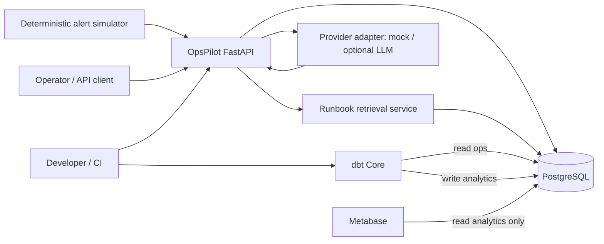
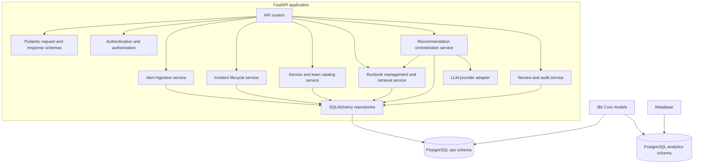
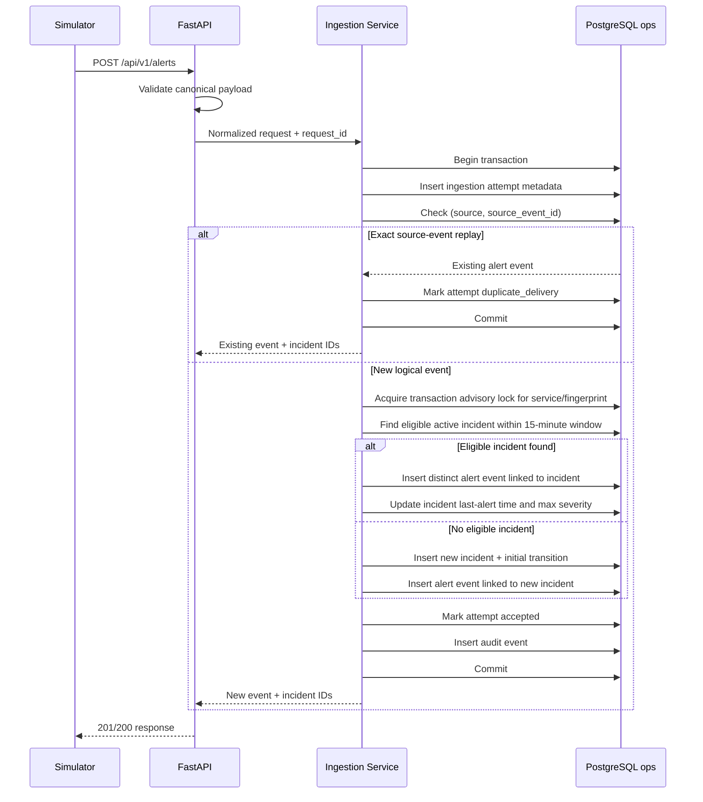
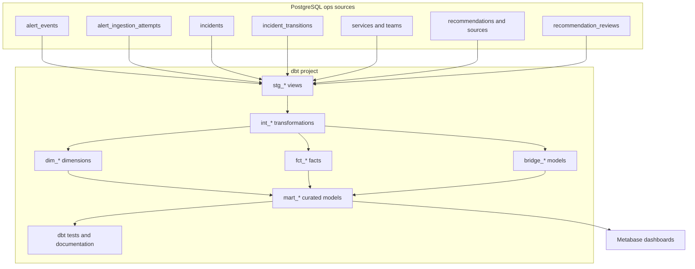
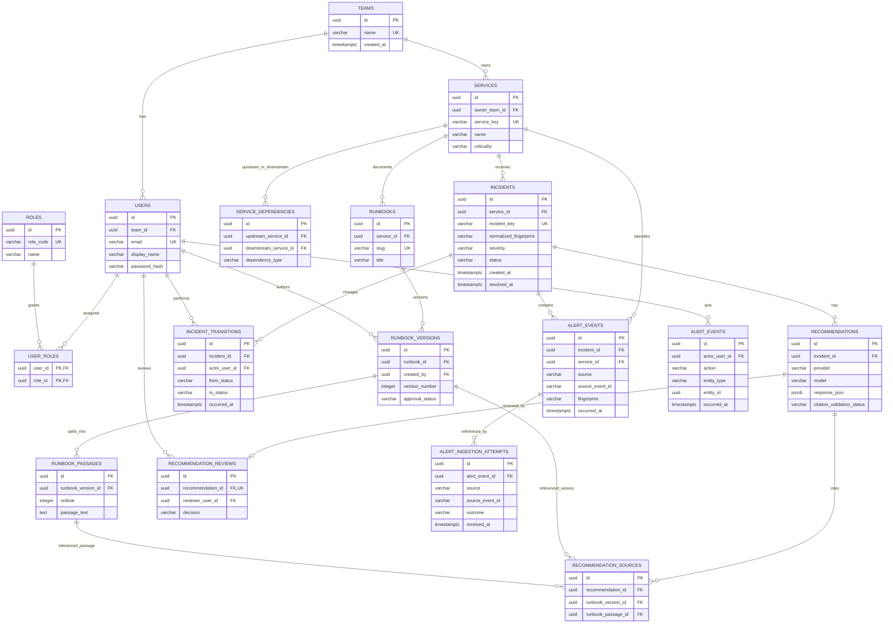

# OpsPilot — Technical Architecture Document (TAD)

**Document status:** Baseline for MVP implementation  
**Version:** 1.0  
**Last updated:** 11 November 2026  
**Related document:** `OpsPilot_PRD.md`  
**Primary implementation target:** Local portfolio MVP  

---

## 1. Purpose and technical objectives

This document translates the OpsPilot product requirements into an implementable technical design. It defines the application boundaries, database model, API contracts, ingestion and incident-correlation behavior, dbt architecture, metric implementation, retrieval and recommendation flow, testing strategy, security model and local deployment.

The architecture must demonstrate both a credible operational application and Analytics Engineering capabilities. The analytical platform is not an afterthought: it has explicit source contracts, dimensional fact/dimension models, governed metrics, data tests, documentation and BI consumers.

### 1.1 Technical objectives

1. Accept and validate simulated alert events through a stable API contract.
2. Make exact delivery retries idempotent without losing distinct alert events.
3. Correlate related events into incidents using explicit, testable rules.
4. Preserve incident lifecycle and audit history.
5. Maintain versioned, approved runbooks and traceable source passages.
6. Generate optional AI suggestions through a provider abstraction, with citation validation and safe fallback.
7. Transform operational records through dbt into tested analytical models.
8. Serve governed analytical marts to Metabase using a read-only database role.
9. Run locally with reproducible setup, migrations, synthetic data and automated checks.

### 1.2 Architecture non-goals

- Production monitoring integrations or production infrastructure access.
- Automatic remediation or execution of generated instructions.
- Multi-tenant SaaS isolation, tenant-specific schemas or PostgreSQL RLS in the single-organization MVP.
- A separate cloud warehouse in the first release.
- Vector search before keyword-search evaluation demonstrates a need.
- Distributed background processing before a real workload requires it.
- Enterprise SSO, complex workflow orchestration or a custom React frontend.

---

## 2. Architecture decisions

| ID | Decision | MVP choice | Reason / trade-off |
|---|---|---|---|
| ADR-001 | Operational API | Python 3.12+, FastAPI, Pydantic | Typed validation and automatic OpenAPI documentation. |
| ADR-002 | Persistence | PostgreSQL, SQLAlchemy, Alembic | Relational integrity, JSONB for bounded metadata and a simple local stack. |
| ADR-003 | Storage separation | One PostgreSQL database with `ops` and `analytics` schemas | Separates workload ownership without operating two databases. |
| ADR-004 | Transformations | dbt Core with PostgreSQL adapter | Makes SQL transformations, tests, docs and lineage visible. |
| ADR-005 | BI | Metabase | Provides dashboards without building a custom BI frontend. |
| ADR-006 | Retrieval | PostgreSQL full-text search first | Easier to evaluate and operate; avoids premature embedding infrastructure. |
| ADR-007 | AI integration | Provider interface with deterministic mock required | Core demo and tests remain reliable without a paid API. |
| ADR-008 | Alert delivery identity | Unique `(source, source_event_id)` | Separates exact delivery replay from semantic alert similarity. |
| ADR-009 | Alert correlation | Service + fingerprint + 15-minute event-time window | Transparent deterministic grouping rule. |
| ADR-010 | Event retention | Store each distinct accepted logical event | Preserves alert volume and repeat-alert analytics. |
| ADR-011 | Incident history | Append-only transition rows plus current incident state | Supports timelines and lifecycle analysis. |
| ADR-012 | Analytical models | Dimensional facts/dimensions plus curated marts | Demonstrates explicit grain and reusable metrics. |
| ADR-013 | Runtime jobs | Synchronous MVP workflow | Fewer moving parts; add a queue only if latency/throughput requires it. |
| ADR-014 | Tenant model | Single organization | Avoids implementing an unused tenancy/security boundary. |

### 2.1 Key terminology

These concepts must not be conflated:

- **Delivery attempt:** One HTTP request received by OpsPilot.
- **Logical alert event:** One distinct source event accepted by OpsPilot.
- **Exact delivery replay:** A second delivery of the same `(source, source_event_id)`; recorded as an attempt but does not create another logical alert event.
- **Repeat/correlated alert event:** A distinct accepted event whose fingerprint is correlated to an existing incident; it remains stored as its own event row.
- **Incident:** The operational case grouping one or more related logical alert events.
- **Recommendation:** One generated advisory response for an incident.
- **Recommendation source:** One approved runbook passage used/cited by a recommendation.

This distinction is required for correct ingestion, correlation and analytics metrics.

---

## 3. System context and architecture

### 3.1 System context



### 3.2 Logical component architecture



### 3.3 Component responsibilities

| Component | Responsibility | Must not do |
|---|---|---|
| API routers | HTTP contract, auth dependency, response mapping and status codes | Contain SQL-heavy business logic. |
| Pydantic schemas | Validate requests and serialize responses | Replace database constraints. |
| Alert ingestion service | Normalize, hash, deduplicate exact deliveries, fingerprint and correlate | Drop distinct repeat alert events. |
| Incident service | Create incidents, enforce lifecycle transitions and append transition records | Allow arbitrary status updates. |
| Catalog service | Maintain services, teams and dependency graph | Own analytical metric calculations. |
| Knowledge service | Publish versioned runbooks, prepare passages and search approved evidence | Return unapproved versions to recommendation generation. |
| Recommendation service | Retrieve evidence, invoke provider, validate structured output/citations and persist result | Execute suggestions or perform production actions. |
| Review/audit service | Store human decisions and append audit records | Rewrite prior audit events. |
| SQLAlchemy repositories | Database access and transaction integration | Duplicate business rules across endpoints. |
| dbt | Transform operational sources and publish analytical models | Mutate operational source records. |
| Metabase | Query curated analytical models | Query/write operational tables with its application account. |

---

## 4. Data architecture and ownership boundaries

### 4.1 PostgreSQL schema ownership

| Schema | Owner | Contents | Write path |
|---|---|---|---|
| `ops` | Application / Alembic | Operational entities, event history, users, runbooks, recommendations and audit records | FastAPI application role; schema changes through migration role |
| `analytics` | dbt | Staging, intermediate, dimensions, facts, bridges and marts | dbt role only |

The schema split is a logical and permission boundary, not physical workload isolation. For this MVP, both schemas share the same PostgreSQL instance.

### 4.2 Database roles

Create distinct PostgreSQL roles/users:

| Database role | Permissions |
|---|---|
| `opspilot_migrator` | Owns schema changes and runs Alembic migrations. Do not use as the normal API connection. |
| `opspilot_app` | Read/write required `ops` tables; no write access to `analytics`; no DDL. |
| `opspilot_dbt` | Read `ops`; create/read/update/drop objects in `analytics`; no mutation of `ops`. |
| `opspilot_metabase` | Read-only access to approved `analytics` views/tables; no access to `ops`. |

Use least-privilege grants and default privileges. Metabase must not connect as the database owner or application role.

### 4.3 Source-of-truth rules

- Operational application state is owned by `ops`.
- Incident transition history is owned by `ops.incident_transitions`; the current status in `ops.incidents` is a current-state convenience field maintained in the same transaction.
- Exact source-event identity is protected by a unique constraint in `ops.alert_events`.
- Every HTTP intake request is represented by `ops.alert_ingestion_attempts` where the application can safely determine the attempt metadata.
- Runbook version content is immutable after approval.
- Recommendation source references are stored separately from generated response text.
- Analytical definitions are implemented in dbt; dashboards consume the approved marts rather than reimplementing formulas.

---

## 5. Core data flow

### 5.1 Alert ingestion sequence



### 5.2 Incident status transition sequence

1. API authenticates the actor and checks the role.
2. Incident service begins a transaction.
3. It selects the incident row `FOR UPDATE`.
4. It validates `(current_status, requested_status)` against the transition matrix.
5. It updates current status and relevant timestamps.
6. It inserts an `incident_transitions` row.
7. It inserts a corresponding `audit_events` row.
8. It commits once; if any step fails, the transaction rolls back.

### 5.3 dbt transformation sequence



---

## 6. Operational database ERD

### 6.1 Entity relationship diagram

The diagram shows the core MVP relationships. Audit entity references are polymorphic and therefore are not represented as ordinary foreign keys.



### 6.2 Relationship rules

- A team may own many services; a service has zero or one current owner team.
- A service may depend on many upstream services and may be a dependency of many downstream services. `service_dependencies` stores directed edges.
- A service may have many incidents and many alert events.
- An incident belongs to exactly one service in the MVP and contains one or more accepted alert events.
- An incident has many transition rows; each transition may be performed by a user or by the system.
- A runbook may be service-specific (`service_id` populated) or global (`service_id` null).
- A runbook has one or more immutable versions; each version has ordered passages.
- A recommendation belongs to one incident and may cite zero or more passages.
- A recommendation may have one review in the MVP.
- An ingestion attempt may point to an accepted alert event, including when the attempt is an exact replay. Rejected attempts have no alert-event reference.
- Audit events use an entity type plus entity UUID to support multiple entity kinds; application code validates references and action names.

---

## 7. Operational data dictionary

All timestamps use PostgreSQL `timestamptz` and are written in UTC. UUID primary keys are generated by the application or database. `created_at` / `updated_at` fields are not repeated in every explanation below, but are included where shown. The database is single-organization in the MVP; do not add a tenant key unless the product scope changes.

### 7.1 `ops.teams`

| Column | Type | Null? | Key / rule | Meaning |
|---|---|---:|---|---|
| `id` | uuid | No | PK | Stable team identifier. |
| `name` | varchar(120) | No | Unique | Team display name. |
| `description` | text | Yes | — | Optional team description. |
| `created_at` | timestamptz | No | Default now() | Creation timestamp. |
| `updated_at` | timestamptz | No | Default now() | Last update timestamp. |

### 7.2 `ops.users`

| Column | Type | Null? | Key / rule | Meaning |
|---|---|---:|---|---|
| `id` | uuid | No | PK | User identifier. |
| `team_id` | uuid | Yes | FK → `teams.id` | User's primary team, if assigned. |
| `email` | varchar(254) | No | Unique | Login identifier; never expose unnecessarily in analytics. |
| `display_name` | varchar(120) | No | — | Operator display name. |
| `password_hash` | text | No | — | Strong one-way password hash; never log or return. |
| `is_active` | boolean | No | Default true | Whether the user can authenticate. |
| `created_at` | timestamptz | No | Default now() | Creation timestamp. |
| `updated_at` | timestamptz | No | Default now() | Last update timestamp. |

### 7.3 `ops.roles`

| Column | Type | Null? | Key / rule | Meaning |
|---|---|---:|---|---|
| `id` | uuid | No | PK | Role identifier. |
| `role_code` | varchar(40) | No | Unique | Stable role code: `admin`, `on_call_engineer`, `analyst`. |
| `name` | varchar(100) | No | — | Role display name. |
| `description` | text | Yes | — | Permission summary. |

### 7.4 `ops.user_roles`

| Column | Type | Null? | Key / rule | Meaning |
|---|---|---:|---|---|
| `user_id` | uuid | No | PK part; FK → `users.id` | User assigned the role. |
| `role_id` | uuid | No | PK part; FK → `roles.id` | Assigned role. |
| `assigned_at` | timestamptz | No | Default now() | Assignment timestamp. |

Primary key: (`user_id`, `role_id`).

### 7.5 `ops.services`

| Column | Type | Null? | Key / rule | Meaning |
|---|---|---:|---|---|
| `id` | uuid | No | PK | Service identifier. |
| `service_key` | varchar(80) | No | Unique | Stable machine-readable service key used by alert payloads. |
| `name` | varchar(160) | No | — | Human-readable service name. |
| `description` | text | Yes | — | Service purpose. |
| `owner_team_id` | uuid | Yes | FK → `teams.id` | Current owning team. |
| `criticality` | varchar(20) | No | Check: critical/high/medium/low | Business/operational criticality. |
| `environment` | varchar(40) | No | Default `demo` | Environment label for simulated records. |
| `is_active` | boolean | No | Default true | Whether new alerts may map to this service. |
| `created_at` | timestamptz | No | Default now() | Creation timestamp. |
| `updated_at` | timestamptz | No | Default now() | Last update timestamp. |

### 7.6 `ops.service_dependencies`

| Column | Type | Null? | Key / rule | Meaning |
|---|---|---:|---|---|
| `id` | uuid | No | PK | Dependency edge identifier. |
| `upstream_service_id` | uuid | No | FK → `services.id` | Service that provides a dependency. |
| `downstream_service_id` | uuid | No | FK → `services.id` | Service that depends on the upstream service. |
| `dependency_type` | varchar(40) | No | Controlled value | Example: `runtime`, `data`, `network`, `external_api`. |
| `created_at` | timestamptz | No | Default now() | Edge creation timestamp. |

Constraints: unique (`upstream_service_id`, `downstream_service_id`); upstream and downstream must differ.

### 7.7 `ops.incidents`

| Column | Type | Null? | Key / rule | Meaning |
|---|---|---:|---|---|
| `id` | uuid | No | PK | Incident identifier. |
| `incident_key` | varchar(40) | No | Unique | Human-readable identifier, e.g. `INC-000123`. |
| `service_id` | uuid | No | FK → `services.id` | Service affected by the incident. |
| `title` | varchar(240) | No | — | Incident title. |
| `description` | text | Yes | — | Initial or maintained summary. |
| `normalized_fingerprint` | varchar(128) | No | Indexed with service | Fingerprint used for correlation and recurrence. |
| `fingerprint_version` | smallint | No | Default 1 | Version of fingerprint algorithm. |
| `severity` | varchar(20) | No | Check: critical/high/medium/low | Current highest severity among associated accepted alerts. |
| `status` | varchar(24) | No | Check: open/acknowledged/investigating/resolved | Current lifecycle state. |
| `first_alert_occurred_at` | timestamptz | No | — | Earliest event time associated with the incident. |
| `last_alert_occurred_at` | timestamptz | No | Indexed with service/fingerprint | Latest event time associated with the incident. |
| `first_acknowledged_at` | timestamptz | Yes | — | First accepted acknowledgement timestamp; never reset on reopen. |
| `first_resolved_at` | timestamptz | Yes | — | First accepted resolution timestamp; never reset on reopen. |
| `resolved_at` | timestamptz | Yes | — | Latest resolution timestamp only while current status is `resolved`; cleared on reopen. |
| `reopen_count` | integer | No | Default 0; >= 0 | Number of accepted transitions from resolved to open. |
| `created_at` | timestamptz | No | Default now() | Incident creation timestamp. |
| `updated_at` | timestamptz | No | Default now() | Last incident update timestamp. |

### 7.8 `ops.alert_ingestion_attempts`

One row represents one received API attempt that the application has classified. The table allows exact replay attempts to be measured without creating duplicate logical alert events.

| Column | Type | Null? | Key / rule | Meaning |
|---|---|---:|---|---|
| `id` | uuid | No | PK | Ingestion attempt identifier. |
| `source` | varchar(80) | Yes | — | Source identifier, if parseable. |
| `source_event_id` | varchar(160) | Yes | — | Logical source event identity, if parseable. |
| `payload_hash` | varchar(64) | No | — | SHA-256 hash of the received/canonicalized request bytes or safe normalized representation; raw payload is not retained here. |
| `outcome` | varchar(32) | No | Check: accepted/duplicate_delivery/rejected | Final processing outcome. |
| `alert_event_id` | uuid | Yes | FK → `alert_events.id` | Canonical event associated with accepted or replayed attempt. Null for rejected attempts. |
| `request_id` | varchar(80) | Yes | Indexed | Request correlation ID. |
| `validation_error_code` | varchar(80) | Yes | — | Safe machine-readable reason for rejection. |
| `received_at` | timestamptz | No | Default now() | Time the attempt reached the application. |

Do not store an unfiltered raw request body in this table. If validation fails, store only safe metadata and a payload hash.

### 7.9 `ops.alert_events`

One row represents one distinct accepted logical alert event. Exact delivery retries do not insert another row; separate source event IDs with the same fingerprint do.

| Column | Type | Null? | Key / rule | Meaning |
|---|---|---:|---|---|
| `id` | uuid | No | PK | Canonical alert event identifier. |
| `source` | varchar(80) | No | Part of unique key | Source system/simulator. |
| `source_event_id` | varchar(160) | No | Unique with source | Stable logical event ID from the source. |
| `incident_id` | uuid | No | FK → `incidents.id`; indexed | Incident to which the event is correlated. |
| `service_id` | uuid | No | FK → `services.id` | Resolved service. |
| `fingerprint` | varchar(128) | No | Indexed with service/time | Normalized fingerprint used for correlation. |
| `fingerprint_version` | smallint | No | Default 1 | Fingerprint algorithm version. |
| `alert_type` | varchar(80) | No | — | Normalized alert category. |
| `severity` | varchar(20) | No | Check | Severity assigned to this event. |
| `resource` | varchar(160) | Yes | — | Safe resource identifier. |
| `message` | varchar(1000) | No | — | Sanitized alert message. |
| `occurred_at` | timestamptz | No | Indexed | Time the alert event occurred at source. |
| `received_at` | timestamptz | No | Default now() | Time OpsPilot received the event. |
| `payload_hash` | varchar(64) | No | — | Hash for integrity/troubleshooting; not a reversible payload store. |
| `normalized_metadata` | jsonb | No | Default `{}` | Allow-listed, sanitized attributes only. |
| `is_repeat_alert` | boolean | No | Default false | True when attached to an incident that already had an event. |
| `correlation_reason` | varchar(80) | No | — | Example: `new_incident` or `matched_fingerprint_window`. |
| `created_at` | timestamptz | No | Default now() | Row creation timestamp. |

Unique constraint: (`source`, `source_event_id`).

### 7.10 `ops.incident_transitions`

| Column | Type | Null? | Key / rule | Meaning |
|---|---|---:|---|---|
| `id` | uuid | No | PK | Transition identifier. |
| `incident_id` | uuid | No | FK → `incidents.id`; indexed | Incident whose state changed. |
| `from_status` | varchar(24) | Yes | Null only for initial transition | Prior status. |
| `to_status` | varchar(24) | No | Check | New status. |
| `actor_type` | varchar(20) | No | Check: user/system | Type of actor. |
| `actor_user_id` | uuid | Yes | FK → `users.id` | Human actor, null for system action. |
| `notes` | text | Yes | — | Optional safe transition note. |
| `request_id` | varchar(80) | Yes | Indexed | Request correlation ID. |
| `occurred_at` | timestamptz | No | Default now() | Transition timestamp. |

### 7.11 `ops.runbooks`

| Column | Type | Null? | Key / rule | Meaning |
|---|---|---:|---|---|
| `id` | uuid | No | PK | Logical runbook identifier. |
| `service_id` | uuid | Yes | FK → `services.id` | Service-specific runbook; null means global. |
| `slug` | varchar(120) | No | Unique | Stable URL/API-friendly identifier. |
| `title` | varchar(200) | No | — | Runbook title. |
| `description` | text | Yes | — | Runbook purpose and applicability. |
| `created_by` | uuid | Yes | FK → `users.id` | User who created the logical runbook. |
| `created_at` | timestamptz | No | Default now() | Creation timestamp. |
| `updated_at` | timestamptz | No | Default now() | Last logical metadata update. |

### 7.12 `ops.runbook_versions`

| Column | Type | Null? | Key / rule | Meaning |
|---|---|---:|---|---|
| `id` | uuid | No | PK | Immutable version identifier. |
| `runbook_id` | uuid | No | FK → `runbooks.id` | Parent logical runbook. |
| `version_number` | integer | No | Unique with runbook; >= 1 | Sequential version number. |
| `content_markdown` | text | No | — | Full versioned runbook content. |
| `approval_status` | varchar(20) | No | Check: draft/approved/retired | Version publication state. |
| `created_by` | uuid | No | FK → `users.id` | Author. |
| `approved_by` | uuid | Yes | FK → `users.id` | Approver. |
| `created_at` | timestamptz | No | Default now() | Version creation timestamp. |
| `approved_at` | timestamptz | Yes | — | Approval timestamp. |

Unique constraint: (`runbook_id`, `version_number`). Once approved, content and generated passages are immutable. Create a new version for changes.

### 7.13 `ops.runbook_passages`

| Column | Type | Null? | Key / rule | Meaning |
|---|---|---:|---|---|
| `id` | uuid | No | PK | Stable passage identifier. |
| `runbook_version_id` | uuid | No | FK → `runbook_versions.id` | Version containing the passage. |
| `ordinal` | integer | No | Unique with version | Passage order within version. |
| `heading` | varchar(200) | Yes | — | Section heading, if present. |
| `passage_text` | text | No | — | Exact searchable passage content. |
| `created_at` | timestamptz | No | Default now() | Passage creation timestamp. |

A published version's passages are immutable. Search uses a GIN functional index on `to_tsvector('english', passage_text)` or a stored search vector maintained consistently by the application/database.

### 7.14 `ops.recommendations`

| Column | Type | Null? | Key / rule | Meaning |
|---|---|---:|---|---|
| `id` | uuid | No | PK | Recommendation identifier. |
| `incident_id` | uuid | No | FK → `incidents.id`; indexed | Incident being investigated. |
| `provider` | varchar(60) | No | — | Provider code, e.g. `mock`, `openai`, `gemini`. |
| `model` | varchar(120) | Yes | — | Model identifier when applicable. |
| `prompt_version` | varchar(40) | No | — | Version of the recommendation prompt/contract. |
| `generation_status` | varchar(20) | No | Check: succeeded/failed | Generation outcome. |
| `response_json` | jsonb | Yes | — | Validated structured response; null on failure. |
| `insufficient_evidence` | boolean | No | Default false | Whether the provider explicitly reported insufficient evidence. |
| `citation_validation_status` | varchar(24) | No | Check: valid/invalid/no_sources/not_applicable | Structural source-reference validation result. |
| `latency_ms` | integer | Yes | >= 0 | Provider/orchestration duration. |
| `error_code` | varchar(80) | Yes | — | Safe machine-readable error code. |
| `generated_at` | timestamptz | No | Default now() | Generation request completion/record timestamp. |
| `request_id` | varchar(80) | Yes | Indexed | Request correlation ID. |

Do not store API keys, secret-bearing prompts or unnecessary raw provider payloads.

### 7.15 `ops.recommendation_sources`

| Column | Type | Null? | Key / rule | Meaning |
|---|---|---:|---|---|
| `id` | uuid | No | PK | Recommendation-source row ID. |
| `recommendation_id` | uuid | No | FK → `recommendations.id` | Recommendation citing the evidence. |
| `runbook_version_id` | uuid | No | FK → `runbook_versions.id` | Exact approved version. |
| `runbook_passage_id` | uuid | No | FK → `runbook_passages.id` | Exact passage. |
| `retrieval_rank` | integer | No | >= 1 | Position in retrieved result list. |
| `quoted_text_snapshot` | text | No | — | Exact cited excerpt at generation time. |
| `created_at` | timestamptz | No | Default now() | Link creation timestamp. |

Application validation must verify that the passage belongs to the referenced version and that the version was approved and retrieved for this generation request.

### 7.16 `ops.recommendation_reviews`

| Column | Type | Null? | Key / rule | Meaning |
|---|---|---:|---|---|
| `id` | uuid | No | PK | Review identifier. |
| `recommendation_id` | uuid | No | FK → `recommendations.id`; unique | One review per recommendation in the MVP. |
| `reviewer_user_id` | uuid | No | FK → `users.id` | Human reviewer. |
| `decision` | varchar(20) | No | Check: approved/rejected | Review outcome. |
| `notes` | text | Yes | — | Optional reviewer feedback. |
| `reviewed_at` | timestamptz | No | Default now() | Review timestamp. |

The current review status is derived from this row. Do not maintain a second independently writable status field on `recommendations`.

### 7.17 `ops.audit_events`

| Column | Type | Null? | Key / rule | Meaning |
|---|---|---:|---|---|
| `id` | uuid | No | PK | Audit event identifier. |
| `actor_type` | varchar(20) | No | Check: user/system | Initiating actor type. |
| `actor_user_id` | uuid | Yes | FK → `users.id` | Human actor, when applicable. |
| `action` | varchar(100) | No | Indexed | Controlled action code. |
| `entity_type` | varchar(80) | No | Indexed with entity ID | Entity type affected. |
| `entity_id` | uuid | No | Polymorphic reference | ID of the affected entity. |
| `request_id` | varchar(80) | Yes | Indexed | Request correlation ID. |
| `metadata` | jsonb | No | Default `{}` | Safe, bounded non-secret audit context. |
| `occurred_at` | timestamptz | No | Default now() | Audit timestamp. |

`entity_id` is deliberately polymorphic and does not have a conventional foreign key. Audit metadata must not contain raw alert bodies, tokens, passwords or sensitive provider prompts.

---

## 8. Database constraints, indexes and transaction rules

### 8.1 Required constraints

- Primary key on every entity table.
- Unique `services.service_key`.
- Unique `runbooks.slug`.
- Unique (`source`, `source_event_id`) on `alert_events`.
- Unique (`runbook_id`, `version_number`) on `runbook_versions`.
- Unique (`runbook_version_id`, `ordinal`) on `runbook_passages`.
- Unique `recommendation_reviews.recommendation_id` for one review per recommendation.
- Unique (`upstream_service_id`, `downstream_service_id`) on service dependencies.
- Foreign keys for all ordinary entity relationships.
- Check constraints for enum-like values, nonnegative counters and valid timestamps where appropriate.
- `resolved_at` is non-null when current status is resolved and null otherwise.
- `first_acknowledged_at` and `first_resolved_at` cannot be cleared by ordinary lifecycle operations.

### 8.2 Suggested indexes

| Table | Index |
|---|---|
| `incidents` | (`status`, `created_at` DESC) |
| `incidents` | (`service_id`, `normalized_fingerprint`, `last_alert_occurred_at` DESC) |
| `alert_events` | Unique (`source`, `source_event_id`) |
| `alert_events` | (`incident_id`, `occurred_at`) |
| `alert_events` | (`service_id`, `fingerprint`, `occurred_at`) |
| `alert_ingestion_attempts` | (`received_at`), (`outcome`, `received_at`) |
| `incident_transitions` | (`incident_id`, `occurred_at`) |
| `services` | Unique (`service_key`) |
| `runbook_passages` | GIN full-text index over passage text |
| `runbook_versions` | (`runbook_id`, `version_number` DESC) |
| `recommendations` | (`incident_id`, `generated_at` DESC) |
| `recommendation_reviews` | Unique (`recommendation_id`) |
| `audit_events` | (`entity_type`, `entity_id`, `occurred_at` DESC) |

Add indexes based on observed query plans; do not index every column by default.

### 8.3 Exact delivery idempotency transaction

1. Validate/normalize enough fields to identify `source` and `source_event_id`.
2. Start a database transaction and acquire a transaction-scoped advisory lock derived from `(source, source_event_id)`. This serializes concurrent deliveries of the same logical source event.
3. Check the canonical `alert_events` identity. If it already exists, insert an `alert_ingestion_attempts` row with `duplicate_delivery`, reference the existing event and return it.
4. If it is new, acquire a second transaction-scoped advisory lock derived from `(service_id, fingerprint)`; always acquire locks in this order to avoid inconsistent lock ordering.
5. Correlate to an eligible incident or create a new incident, then insert the canonical event. The unique source identity constraint remains the final concurrency safeguard; use `INSERT ... ON CONFLICT` handling and re-read the existing event if a conflict occurs. Do not leave a newly created incident behind when the event insert loses a race.
6. Insert/update the attempt result and associated audit record in the same transaction.
7. Commit once.

The implementation must be race-safe. A pre-insert `SELECT` alone is not sufficient because two requests can pass the check concurrently; the unique constraint and conflict handling are authoritative.

### 8.4 Incident correlation transaction

To avoid two simultaneous new alerts creating duplicate incidents:

1. Calculate the normalized `(service_id, fingerprint)` correlation key.
2. After acquiring the source-event identity lock (see §8.3), acquire a PostgreSQL transaction-scoped advisory lock derived from the correlation key, or use another demonstrated serialization strategy. Always use the same lock order: source-event identity first, then correlation key.
3. Search active incidents with matching service and fingerprint.
4. Choose the closest eligible candidate whose latest correlated alert event is within 15 minutes of the incoming event's `occurred_at`.
5. If found, attach the new logical alert event and set `is_repeat_alert = true`.
6. If not found, create a new incident and its initial `NULL → open` transition, then attach the event.
7. Update `first_alert_occurred_at` with the minimum event time and `last_alert_occurred_at` with the maximum event time. Update incident severity to the highest severity observed.
8. Commit the event, incident change, ingestion attempt and audit record atomically.

**Out-of-order events:** Compare absolute event-time distance to the existing incident's latest event time, and update min/max timestamps. Cover late-arriving events in tests. Do not use request arrival order as a substitute for event time without documenting that choice.

### 8.5 Status transition transaction

Lock the incident row with `SELECT ... FOR UPDATE`, validate the transition, update the current row, insert the transition and audit rows, then commit. The application service is the only supported write path for incident status.

### 8.6 Referential deletion policy

Operational history should not disappear through cascading deletes. Use `RESTRICT` for historical relationships where deletion would orphan an incident, event, recommendation, review or audit reference. Prefer soft deactivation (`is_active = false`) for services and users. For draft runbook version cleanup, use a deliberate administrative action; approved versions referenced by recommendations must remain.

---

## 9. Incident lifecycle and severity rules

### 9.1 Allowed transitions

| From | To | Allowed |
|---|---|---:|
| null | open | Yes; initial incident creation only |
| open | acknowledged | Yes |
| open | investigating | Yes |
| acknowledged | investigating | Yes |
| acknowledged | resolved | Yes |
| investigating | resolved | Yes |
| resolved | open | Yes; explicit reopen |
| any other pair | any other pair | No |

### 9.2 Timestamp behavior

- On first transition into `acknowledged`, set `first_acknowledged_at` if null.
- On first transition into `resolved`, set `first_resolved_at` if null.
- Whenever an incident enters `resolved`, set current `resolved_at` to the transition timestamp.
- When an incident transitions from `resolved` to `open`, clear current `resolved_at` and increment `reopen_count`.
- On a later resolution, set `resolved_at` again; do not replace `first_resolved_at`.

### 9.3 Severity ordering

The MVP severity order is:

`critical > high > medium > low`

For incident severity, retain the maximum severity observed across accepted alert events. Do not silently lower incident severity because a later alert has a lower severity. A manual severity adjustment, if introduced, must be a separate audited operation and must define whether later events can raise it again.

---

## 10. API architecture and contracts

Base path: `/api/v1`  
Content type: `application/json`  
Timestamps: ISO-8601 with timezone; responses serialize as UTC.  
IDs: UUIDs unless the endpoint explicitly returns a human-readable incident key.

### 10.1 Endpoint inventory

| Method | Route | Purpose |
|---|---|---|
| GET | `/health` | Application and database health. |
| POST | `/api/v1/alerts` | Validate, persist and correlate one alert. |
| GET | `/api/v1/incidents` | Paginated incident search. |
| GET | `/api/v1/incidents/{incident_id}` | Incident, events, current state, timeline and recommendation summary. |
| PATCH | `/api/v1/incidents/{incident_id}/status` | Request an allowed state transition. |
| GET | `/api/v1/incidents/{incident_id}/timeline` | Ordered incident event and transition timeline. |
| GET | `/api/v1/services` | List services. |
| POST | `/api/v1/services` | Create a service (admin). |
| GET | `/api/v1/services/{service_id}` | Service detail and dependencies. |
| GET | `/api/v1/runbooks/search` | Search approved runbook passages. |
| POST | `/api/v1/incidents/{incident_id}/recommendations` | Generate a triage suggestion. |
| GET | `/api/v1/recommendations/{recommendation_id}` | Retrieve a recommendation and source references. |
| POST | `/api/v1/recommendations/{recommendation_id}/review` | Approve or reject a recommendation. |
| POST | `/api/v1/runbooks` | Create logical runbook (admin). |
| POST | `/api/v1/runbooks/{runbook_id}/versions` | Create draft version (admin). |
| POST | `/api/v1/runbook-versions/{version_id}/approve` | Approve/publish version (admin/authorized approver). |

If time is constrained, runbook CRUD can initially be seed-driven; search and immutable approved versions remain required.

### 10.2 `POST /api/v1/alerts`

Request:

```json
{
  "source": "monitoring_simulator",
  "source_event_id": "evt_10001",
  "service_key": "payment-api",
  "alert_type": "high_latency",
  "severity": "critical",
  "occurred_at": "2026-11-10T10:30:00Z",
  "resource": "payment-node-01",
  "message": "API latency exceeded threshold",
  "metadata": {
    "observed_latency_ms": 3200,
    "threshold_ms": 1000
  }
}
```

Response for a newly accepted event:

```json
{
  "ingestion_outcome": "accepted",
  "duplicate_delivery": false,
  "alert_event_id": "<uuid>",
  "incident_id": "<uuid>",
  "incident_key": "INC-000123",
  "correlation_outcome": "new_incident",
  "is_repeat_alert": false
}
```

Response for an exact replay:

```json
{
  "ingestion_outcome": "duplicate_delivery",
  "duplicate_delivery": true,
  "alert_event_id": "<existing-uuid>",
  "incident_id": "<existing-uuid>",
  "incident_key": "INC-000123",
  "correlation_outcome": "existing_event_replayed",
  "is_repeat_alert": false
}
```

Use `201 Created` for a new logical event and `200 OK` for an exact replay. Validation failures return a 4xx response with a stable error code. A replay is not a second accepted logical alert event.

### 10.3 `GET /api/v1/incidents`

Supported query parameters:

- `status`
- `severity`
- `service_key`
- `team_id`
- `created_from`
- `created_to`
- `page` (default 1)
- `page_size` (bounded; e.g. default 25, maximum 100)
- `sort` (allow-listed fields only)

Return a page envelope with items, page, page size and total count (or a cursor envelope if cursor pagination is selected consistently).

### 10.4 `PATCH /api/v1/incidents/{incident_id}/status`

Request:

```json
{
  "to_status": "investigating",
  "notes": "Started checking the database connection pool."
}
```

The caller does not supply `from_status`; the server reads the current status under a row lock. Invalid transitions return `409 Conflict` with a stable `invalid_status_transition` error code.

### 10.5 `GET /api/v1/runbooks/search`

Query parameters:

- `q` (required, bounded length)
- `service_key` (optional)
- `limit` (default 5, maximum 10)

Response result fields:

- `runbook_id`
- `runbook_version_id`
- `runbook_slug`
- `title`
- `service_key` or null for global
- `passage_id`
- `passage_heading`
- `passage_text`
- `retrieval_rank`
- `score` (for diagnostics; not a probability)

Only approved versions can be returned.

### 10.6 `POST /api/v1/incidents/{incident_id}/recommendations`

Request:

```json
{
  "top_k": 5,
  "provider": "mock"
}
```

The server loads incident context; callers cannot supply arbitrary source passages as trusted evidence. The response contains a recommendation ID, structured suggestion, citation validation status and source references.

### 10.7 Recommendation response contract

```json
{
  "incident_summary": "Payment API latency is elevated.",
  "possible_contributors": [
    {
      "hypothesis": "Database connection saturation may be contributing to latency.",
      "confidence_label": "medium"
    }
  ],
  "suggested_checks": [
    {
      "step": "Inspect database connection pool utilization.",
      "reason": "The retrieved runbook describes pool exhaustion as a possible contributor.",
      "source_passage_id": "<uuid>"
    }
  ],
  "insufficient_evidence": false,
  "limitations": [
    "No direct infrastructure telemetry was supplied to OpsPilot."
  ]
}
```

`possible_contributors` are hypotheses, not confirmed root causes. A suggested check must reference a retrieved approved passage. The provider output is validated with Pydantic before persistence.

### 10.8 `POST /api/v1/recommendations/{id}/review`

Request:

```json
{
  "decision": "rejected",
  "notes": "The cited procedure does not match the current service configuration."
}
```

The server derives reviewer identity from authentication. Do not accept `reviewer_user_id` from the request body.

### 10.9 Error model

Use a consistent error envelope:

```json
{
  "error": {
    "code": "invalid_status_transition",
    "message": "The requested incident transition is not allowed.",
    "request_id": "<request-id>"
  }
}
```

Expected status mapping:

- `400`: malformed request or invalid query parameter.
- `401`: missing/invalid authentication when auth is enabled.
- `403`: authenticated user lacks permission.
- `404`: resource not found.
- `409`: idempotency conflict not safely resolvable, invalid state transition, or one-review-per-recommendation conflict.
- `422`: schema/domain validation failure.
- `500`: unexpected internal error; response must not expose stack traces or secrets.

---

## 11. Application code organization

Suggested structure:

```text
app/
├── api/
│   └── v1/
│       ├── alerts.py
│       ├── incidents.py
│       ├── services.py
│       ├── runbooks.py
│       └── recommendations.py
├── core/
│   ├── config.py
│   ├── database.py
│   ├── security.py
│   ├── logging.py
│   └── errors.py
├── models/
│   ├── team.py
│   ├── user.py
│   ├── service.py
│   ├── incident.py
│   ├── alert_event.py
│   ├── runbook.py
│   ├── recommendation.py
│   └── audit.py
├── schemas/
│   ├── alert.py
│   ├── incident.py
│   ├── runbook.py
│   └── recommendation.py
├── repositories/
│   ├── alert_repository.py
│   ├── incident_repository.py
│   ├── catalog_repository.py
│   ├── runbook_repository.py
│   └── recommendation_repository.py
├── services/
│   ├── alert_ingestion.py
│   ├── incident_lifecycle.py
│   ├── catalog.py
│   ├── runbook_retrieval.py
│   ├── recommendation.py
│   ├── citation_validation.py
│   └── audit.py
├── providers/
│   ├── base.py
│   ├── mock_provider.py
│   └── configured_provider.py
└── main.py
```

Guidelines:

- API routes should remain thin.
- Domain rules belong in services and are covered by unit tests.
- Repositories own SQLAlchemy query details.
- Pydantic response models prevent accidental exposure of hashes, credentials or internal fields.
- Configuration is loaded from environment variables and validated on startup.
- Avoid circular imports and a single oversized `services.py` module.

---

## 12. Runbook retrieval architecture

### 12.1 Ingestion and publication

1. Admin creates a logical runbook.
2. Admin creates a draft version with Markdown content.
3. Publication logic parses the content into ordered passages.
4. An authorized user approves the version.
5. The approved content and passages become immutable.
6. Retrieval queries only approved versions.

### 12.2 Passage chunking

For the MVP, split by Markdown headings and bounded paragraph groups. Keep each passage understandable without relying on a distant section. Store the exact passage text and its order. Avoid overly small fragments that lose context.

### 12.3 Search query

Use PostgreSQL full-text search, for example:

```sql
SELECT
    p.id AS passage_id,
    rv.id AS runbook_version_id,
    r.id AS runbook_id,
    r.title,
    p.passage_text,
    ts_rank(
        to_tsvector('english', p.passage_text),
        websearch_to_tsquery('english', :query)
    ) AS score
FROM ops.runbook_passages AS p
JOIN ops.runbook_versions AS rv
  ON rv.id = p.runbook_version_id
JOIN ops.runbooks AS r
  ON r.id = rv.runbook_id
WHERE rv.approval_status = 'approved'
  AND to_tsvector('english', p.passage_text)
      @@ websearch_to_tsquery('english', :query)
  AND (r.service_id = :service_id OR r.service_id IS NULL)
ORDER BY
    (r.service_id = :service_id) DESC,
    score DESC
LIMIT :top_k;
```

This is an illustrative query. Production implementation should handle an empty query, safe parameters, language configuration, service-null behavior and tie-breaking. A service-specific boost must not make an irrelevant result appear relevant without evaluation.

### 12.4 Retrieval result contract

Each result must include the exact `runbook_version_id` and `passage_id`; source title alone is insufficient. Store retrieval rank and the exact quoted excerpt when a recommendation cites a passage.

### 12.5 Retrieval evaluation

- Create 30–50 labeled incident queries.
- Label one or more expected relevant approved passage/version IDs per case.
- Run a deterministic evaluation script.
- Calculate Precision@K, Recall@K and preferably MRR.
- Report macro averages and per-category outcomes when meaningful.
- Keep the dataset, query normalization and evaluation code in Git.
- Add embeddings only if the measured keyword-search limitations justify them.

---

## 13. AI recommendation architecture and safety

### 13.1 Provider interface

Define a provider contract similar to:

```python
class RecommendationProvider(Protocol):
    def generate(
        self,
        incident_context: IncidentContext,
        evidence: list[RetrievedPassage],
    ) -> RecommendationOutput:
        ...
```

The real implementation may be asynchronous, but the interface and application behavior must remain provider-independent.

### 13.2 Provider implementations

- `MockRecommendationProvider`: deterministic and required for CI/demo.
- `ConfiguredLLMProvider`: optional implementation for one selected provider, configured through environment variables.

Never place API keys in source code, prompts, logs or committed `.env` files.

### 13.3 Recommendation orchestration

1. Load incident, service and relevant alert context.
2. Build a sanitized context object; do not pass secret-bearing or unrestricted request payloads.
3. Retrieve up to K approved runbook passages.
4. If retrieval returns no adequate evidence, return an explicit insufficient-evidence result without asking the model to invent sources.
5. Otherwise call the configured provider with incident context and retrieved passages.
6. Parse provider output into a strict Pydantic response schema.
7. Validate every source passage ID against the retrieved candidate set.
8. Validate passage/version/runbook relationships and approval state in the database.
9. Persist the recommendation, source links, validation result and audit event atomically.
10. Return the advisory response to the caller.

### 13.4 Required safety rules

- The provider has no tools or credentials that can access production systems.
- Generated instructions are never executed by OpsPilot.
- Runbook text is treated as data/evidence, not as instructions that can override application policy.
- Prompts explicitly instruct the model not to follow embedded requests to reveal secrets, ignore constraints or execute actions.
- The model may describe hypotheses but must not label a cause as confirmed without adequate evidence.
- Every suggested troubleshooting check must cite a retrieved source passage; otherwise it must be omitted or explicitly labeled unsupported and not presented as an evidence-backed step.
- If evidence is absent, output `insufficient_evidence = true` and explain the limitation.
- Provider errors must produce a safe failure record and must not fabricate a successful recommendation.

### 13.5 Citation validation

For every cited passage:

1. Confirm passage ID exists.
2. Confirm it belongs to the stated runbook version.
3. Confirm the version is approved.
4. Confirm it was in the retrieval candidate set for this generation request.
5. Store the exact cited excerpt snapshot and retrieval rank.

Structural validation does not prove that a quote semantically supports the recommendation. A separately labeled human evaluation must assess evidence support.

### 13.6 Recommendation quality evaluation

Report distinct measures:

- Schema validity rate.
- Citation structural validity rate.
- Human-rated evidence support rate.
- Insufficient-evidence fallback correctness.
- Recommendation review approval/rejection rate.

Do not combine these into one unqualified “AI accuracy” score.

---

## 14. dbt analytics architecture

### 14.1 Project structure

```text
dbt/
├── dbt_project.yml
├── packages.yml                 # Only if packages are actually required
├── profiles.yml                 # Local example only; do not commit secrets
├── models/
│   ├── sources.yml
│   ├── staging/
│   │   ├── stg_alert_events.sql
│   │   ├── stg_alert_ingestion_attempts.sql
│   │   ├── stg_incidents.sql
│   │   ├── stg_incident_transitions.sql
│   │   ├── stg_services.sql
│   │   ├── stg_teams.sql
│   │   ├── stg_recommendations.sql
│   │   └── stg_recommendation_reviews.sql
│   ├── intermediate/
│   │   ├── int_incident_lifecycle.sql
│   │   ├── int_incident_response_times.sql
│   │   ├── int_incident_recurrence.sql
│   │   ├── int_alert_correlation.sql
│   │   └── int_recommendation_outcomes.sql
│   └── marts/
│       ├── core/
│       │   ├── dim_services.sql
│       │   ├── dim_teams.sql
│       │   ├── dim_dates.sql
│       │   ├── dim_severity.sql
│       │   ├── dim_incident_status.sql
│       │   ├── fct_alert_ingestion_attempts.sql
│       │   ├── fct_alert_events.sql
│       │   ├── fct_incidents.sql
│       │   ├── fct_incident_transitions.sql
│       │   ├── fct_recommendations.sql
│       │   └── bridge_recommendation_sources.sql
│       └── reporting/
│           ├── mart_incident_overview.sql
│           ├── mart_service_daily.sql
│           ├── mart_alert_daily.sql
│           └── mart_recommendation_daily.sql
├── tests/
│   ├── assert_nonnegative_incident_durations.sql
│   ├── assert_resolved_incidents_have_resolution_timestamp.sql
│   ├── assert_alert_events_have_incidents.sql
│   ├── assert_first_acknowledgement_not_before_creation.sql
│   ├── assert_recommendation_sources_are_approved.sql
│   └── assert_metric_denominators_are_valid.sql
├── macros/
├── seeds/
│   ├── severity_reference.csv
│   └── incident_status_reference.csv
└── snapshots/                   # Only for selected justified history use cases
```

### 14.2 Source definitions

Declare source tables for:

- `alert_events`
- `alert_ingestion_attempts`
- `incidents`
- `incident_transitions`
- `services`
- `teams`
- `recommendations`
- `recommendation_sources`
- `recommendation_reviews`

Set `loaded_at_field` to an appropriate ingestion/update timestamp for freshness checks where meaningful. Source freshness should be interpreted carefully for a local simulated system; stale data is not necessarily a broken pipeline when no new alerts were generated.

### 14.3 Layer responsibilities

| Layer | Prefix | Responsibility | Typical materialization |
|---|---|---|---|
| Sources | source declarations | Declare operational source tables and freshness rules. | Metadata only |
| Staging | `stg_` | Rename, cast, standardize, select and lightly clean source records. Avoid complex business logic. | View |
| Intermediate | `int_` | Join, deduplicate according to declared identity, calculate lifecycle timestamps, derive recurrence and business logic. | View/table as needed |
| Dimensions | `dim_` | Provide reusable descriptive entities and surrogate keys. | Table |
| Facts | `fct_` | Represent measurable business events/processes at a declared grain. | Table initially |
| Bridges | `bridge_` | Represent many-to-many relationships, e.g. recommendation-to-source passages. | Table |
| Reporting marts | `mart_` | Curated, consumer-ready metrics and aggregates for Metabase. | Table |

### 14.4 Fact model grains

| Model | Grain | Important fields / measures |
|---|---|---|
| `fct_alert_ingestion_attempts` | One row per HTTP ingestion attempt | Attempt ID, outcome, received timestamp, source, replay indicator, referenced event key. |
| `fct_alert_events` | One row per distinct accepted logical alert event | Event ID, incident key, service key, event time, severity, fingerprint, repeat-alert flag. |
| `fct_incidents` | One row per incident, current/latest lifecycle state | Incident ID, service key, severity/status keys, created/acknowledged/resolved timestamps, MTTA seconds, MTTR seconds when eligible, reopen count. |
| `fct_incident_transitions` | One row per accepted incident state transition | Transition ID, incident ID, from/to status, actor type, transition timestamp. |
| `fct_recommendations` | One row per recommendation generation attempt recorded in `ops.recommendations` | Recommendation ID, incident ID, provider/model, generation status, citation status, insufficient-evidence flag, review outcome when available. |
| `bridge_recommendation_sources` | One row per recommendation-to-runbook-passage citation | Recommendation ID, runbook version ID, passage ID, retrieval rank, structural validity. |

### 14.5 Dimension grains

| Model | Grain | MVP behavior |
|---|---|---|
| `dim_services` | One row per current service | Current service name, criticality, owner team, active flag. Historical ownership tracking deferred unless implemented with a snapshot/effective-dated source. |
| `dim_teams` | One row per current team | Current team attributes. |
| `dim_dates` | One row per calendar date | Calendar date, day, week, month, quarter, year and weekday fields. |
| `dim_severity` | One row per severity code | Stable severity label and numeric sort order. |
| `dim_incident_status` | One row per incident status | Stable status label and sort order. |

Dimensions use surrogate keys generated with a consistent dbt method, while retaining operational UUID/business identifiers for lineage and joins. Do not create a full SCD Type 2 design for every dimension without a historical reporting need.

### 14.6 Intermediate model responsibilities

- `int_incident_lifecycle`: derive first acknowledgement, first resolution, current resolution and reopen-aware lifecycle attributes using transition history and operational timestamps.
- `int_incident_response_times`: calculate eligible acknowledgement/resolution durations and expose explicit eligibility flags.
- `int_incident_recurrence`: match incidents by service and normalized fingerprint under the seven-day post-resolution rule.
- `int_alert_correlation`: classify new-incident versus repeat/correlated events and expose correlation attributes.
- `int_recommendation_outcomes`: join recommendations to the single review record, derive approved/rejected/unreviewed state and source quality indicators.

### 14.7 Reporting marts

| Model | Grain | Intended consumers |
|---|---|---|
| `mart_incident_overview` | One row per incident | Incident explorer and executive drill-through. |
| `mart_service_daily` | One row per service per calendar date | Service performance and daily incident trends. |
| `mart_alert_daily` | One row per service, date and severity | Alert volume, repeat-alert share and severity patterns. |
| `mart_recommendation_daily` | One row per service and recommendation date | Recommendation volume, review outcomes and citation indicators. |

If a dashboard needs a different grain, add a documented mart rather than hiding a complex aggregation in a Metabase question.

### 14.8 dbt materialization strategy

- Staging: views.
- Intermediate: views initially; tables only when there is a demonstrated reuse/performance benefit.
- Dimensions/facts: tables initially for simple and predictable local builds.
- Reporting marts: tables initially.
- Incremental models: deferred until full refresh becomes measurably slow or data volume justifies incremental logic. If introduced, define a stable unique key, late-arriving event strategy and full-refresh reconciliation.
- Snapshots: use selectively, for example service ownership history, only if the product needs historical ownership reporting.

### 14.9 dbt tests and documentation

Use generic tests:

- `not_null` for primary/business keys and required attributes.
- `unique` for fact primary keys and dimension surrogate keys.
- `relationships` for foreign keys.
- `accepted_values` for status, severity and outcome fields.

Use singular SQL tests for:

- Negative or impossible incident durations.
- Resolved status/timestamp mismatch.
- Acknowledgement timestamp before incident creation.
- Orphan alert events.
- Cited source passage not belonging to an approved version.
- Duplicate fact grains.
- Invalid metric denominators.
- Repeat-alert classification inconsistencies.

Add model and column descriptions in YAML. Generate and publish dbt docs artifacts or include screenshots of lineage in the repository.

---

## 15. Metric implementation details

The Product Requirements Document contains the business definitions. This section maps them to the technical data model.

### 15.1 Incident volume

Source: `fct_incidents`.  
Measure: count distinct incident IDs by `created_at` date, service and severity.

### 15.2 MTTA

Source: `fct_incidents` / `int_incident_response_times`.  
Measure: average `first_acknowledged_at - created_at` for incidents with a valid acknowledgement. Expose `eligible_incident_count`. Reject negative durations in tests.

### 15.3 MTTR

Source: `fct_incidents` / `int_incident_response_times`.  
Measure: average `resolved_at - created_at` for incidents currently resolved. Use the latest successful resolution timestamp. Reopened incidents are not eligible while currently reopened; once resolved again, the latest resolution timestamp is used. This is wall-clock time to final resolution and includes the period between first resolution and reopening.

### 15.4 Recurrence rate

Source: `int_incident_recurrence` and `fct_incidents`.

For each incident, search for a prior incident with the same service and normalized fingerprint whose `resolved_at` is earlier than the new incident's `created_at`, with the new creation timestamp no more than seven days after that prior resolution. Mark the new incident as recurring when such a prior incident exists.

For the seven-day observation requirement, exclude incidents too recent to have a full seven-day observation window. Document the precise date boundary in SQL and tests. The metric is a repeat-failure proxy, not a root-cause assertion.

### 15.5 Repeat-alert share

Source: `fct_alert_events`.  
Formula: count of accepted event rows with `is_repeat_alert = true` divided by all accepted event rows in the filter context. The events remain present in the denominator.

### 15.6 Delivery replay rate

Source: `fct_alert_ingestion_attempts`.  
Formula: count attempts with outcome `duplicate_delivery` divided by all attempts included in the defined evaluation population. Rejected malformed attempts should be reported separately and not silently mixed into a “valid attempt” denominator unless the dashboard label explicitly says all requests.

### 15.7 Recommendation acceptance rate

Source: `fct_recommendations` joined to `recommendation_reviews`.  
Formula: approved / (approved + rejected). Exclude unreviewed and failed generations. Show reviewed count.

### 15.8 Citation validation rate

Source: `fct_recommendations`.  
Formula: recommendations with `citation_validation_status = 'valid'` / recommendations that have at least one citation and completed successfully. Report no-source and insufficient-evidence cases separately.

### 15.9 Metric governance rules

- Every metric is defined once in dbt documentation and marts.
- Dashboard labels use the same name and definition.
- A denominator count is exposed where useful.
- Null means not eligible/not available; it must not be silently cast to zero.
- Timezone used for date aggregation is documented. Store timestamps in UTC; use UTC for the baseline demo unless a report timezone is explicitly configured.
- Metric SQL has tests and at least one reconciliation fixture.

---

## 16. Metabase architecture

### 16.1 Connection

Metabase connects as `opspilot_metabase` and receives read-only access to `analytics` objects only.

### 16.2 Dashboard set

1. **Executive overview**
   - Incident volume, currently open incidents, critical incidents, MTTA, MTTR, recurrence rate and incident trend.
2. **Service performance**
   - Incidents by service, MTTA/MTTR by service, severity mix and repeat failures.
3. **Alert and incident analytics**
   - Alert event volume, delivery replay rate, repeat-alert share, category/severity mix and incident duration distribution.
4. **Recommendation quality**
   - Recommendation volume, approved/rejected outcomes, acceptance rate, citation validation and insufficient-evidence frequency.

### 16.3 Dashboard rules

- Query curated `mart_*` models or approved facts where drill-through is required.
- Do not duplicate metric SQL independently across cards.
- Include clear date filters and service/team/severity filters where meaningful.
- Label the dataset as synthetic/demo data.
- Show sample counts next to averages and rates.
- Reconcile card totals to SQL queries against the same mart.

---

## 17. Authentication, authorization and database security

### 17.1 Application roles

| Action | Admin | On-call engineer | Analyst |
|---|---:|---:|---:|
| Read incidents and timeline | Yes | Yes | Yes |
| Create/ingest alert | Yes | Yes (API/simulator) | No |
| Change incident status | Yes | Yes | No |
| Read services | Yes | Yes | Yes |
| Create/update services | Yes | No | No |
| Create/publish runbooks | Yes | No | No |
| Search approved runbooks | Yes | Yes | Yes |
| Generate recommendation | Yes | Yes | Optional read-only policy; default no |
| Approve/reject recommendation | Yes | Yes | No |
| View analytics dashboards | Yes | Yes | Yes |
| Manage users/roles | Yes | No | No |

The application must enforce this matrix in the API. PostgreSQL grants are an additional database boundary, not a replacement for application authorization.

### 17.2 Authentication implementation

For the MVP:

- Use a standard password hashing library such as Argon2id (or a vetted framework integration).
- Use short-lived signed bearer tokens if implementing JWT authentication.
- Validate the token on protected API routes.
- Derive actor identity from the authenticated principal; do not accept reviewer/actor IDs from request bodies.
- Seed local demo accounts only through an explicit development seed script.
- Do not commit live credentials or real secrets.

If auth is postponed, clearly label the demo as local-only and do not expose it publicly with unrestricted write endpoints.

### 17.3 Single-organization decision

The MVP has one organization and therefore does not require tenant IDs or PostgreSQL row-level security. Do not add RLS as decorative complexity. If multiple customers with strict isolation become a real requirement, redesign identity, ownership, queries, policies and adversarial isolation tests before claiming multi-tenancy.

### 17.4 Audit immutability

- App role receives `INSERT` and `SELECT` on audit records, not `UPDATE` or `DELETE`.
- The application exposes no edit/delete audit endpoint.
- Operational correction is recorded as a new event.
- This protects against ordinary application-level changes; it is not tamper-proof against a database owner/superuser. Document that limitation honestly.

---

## 18. Logging, observability and error handling

### 18.1 Structured logging fields

Where applicable, include:

- `timestamp`
- `level`
- `service_name`
- `request_id`
- `actor_id` (internal UUID only where safe)
- `incident_id`
- `alert_event_id`
- `operation`
- `duration_ms`
- `outcome`
- `error_code`

Do not log passwords, tokens, provider API keys, full raw payloads, or secret-bearing metadata.

### 18.2 Operational measures

Track/log at least:

- Alert ingestion accepted/rejected/duplicate-delivery counts.
- Incident creation and correlation outcomes.
- Invalid lifecycle transition count.
- Runbook retrieval latency and result count.
- Recommendation generation success/failure and latency.
- Citation validation failures.
- Database connection failures.
- dbt build/test status and duration.

OpenTelemetry traces are a production-polish enhancement; structured logs and request correlation are the baseline.

### 18.3 Error handling

- Use stable machine-readable error codes.
- Do not return stack traces to clients.
- Roll back failed transactions.
- Persist safe failure/audit information where it can be done without masking the original failure.
- Do not record a recommendation as successfully generated if provider or schema validation fails.

---

## 19. Docker Compose and local runtime

### 19.1 Required services

| Service | Purpose | Persistent state |
|---|---|---|
| `postgres` | Operational and analytical database | Named PostgreSQL volume |
| `api` | FastAPI application | No required persistent local filesystem state |
| `metabase` | BI dashboard application | Optional named Metabase application-data volume |

Run dbt from the developer environment or as a one-off Compose profile/service. It must connect with the `opspilot_dbt` account.

### 19.2 Startup order

1. PostgreSQL starts and passes health check.
2. Database roles/schemas are initialized by bootstrap SQL or migration setup.
3. Alembic applies operational migrations using the migrator identity.
4. FastAPI starts using the app identity.
5. Seed command creates demo teams, users, services and runbooks.
6. Synthetic generator creates operational scenarios.
7. dbt build runs using the dbt identity.
8. Metabase connects with the analytics-only identity.

Do not rely solely on container start order; use health checks and explicit migration/seed commands.

### 19.3 Environment variables

Maintain `.env.example` with placeholders only. Examples:

```text
APP_ENV=local
APP_HOST=0.0.0.0
APP_PORT=8000
DATABASE_URL=postgresql+psycopg://...
JWT_SECRET_KEY=replace-for-local-development
LLM_PROVIDER=mock
LLM_API_KEY=
DBT_TARGET=dev
```

Actual `.env` must be ignored by Git. Prefer separate database URLs/users for the app, migrator, dbt and Metabase.

### 19.4 Local developer commands

Document commands equivalent to:

```bash
# Start infrastructure

docker compose up -d postgres

# Apply operational schema migrations
alembic upgrade head

# Start the API (development)
uvicorn app.main:app --reload

# Seed base reference data and runbooks
python -m scripts.seed_demo_data

# Generate deterministic scenario data
python -m scripts.generate_data.generate_incidents --seed 42

# Run application tests
pytest

# Run lint/format checks
ruff check .
ruff format --check .

# Build and test dbt models
cd dbt
dbt deps
dbt build --target dev
dbt docs generate
```

Commands may be adapted to the final package layout; the README must provide the exact verified commands.

---

## 20. Testing architecture

### 20.1 Python unit tests

Test pure business logic:

- Alert normalization.
- Fingerprint stability and version behavior.
- Severity ordering.
- Incident correlation eligibility.
- Lifecycle transition matrix.
- Timestamp behavior for acknowledgement, resolution and reopening.
- Recommendation schema parsing.
- Citation validation rules.
- Authorization policy functions.

### 20.2 API/integration tests

Use a dedicated test database and verify:

- Valid alert creation.
- Exact replay returns the existing event.
- Distinct repeated fingerprint events remain distinct and correlate correctly.
- Concurrent duplicate deliveries cannot create two canonical events.
- Concurrent matching alerts cannot create unnecessary parallel incidents.
- Unknown service and invalid payload behavior.
- Pagination and filters.
- Valid/invalid status transitions.
- Timeline and audit rows are written atomically.
- Only approved runbooks are retrieved.
- Recommendation citations must point to retrieved approved passages.
- One review per recommendation is enforced.

### 20.3 dbt tests

Run `dbt build` and validate:

- Unique/not-null keys.
- Relationships.
- Accepted values.
- Fact grain uniqueness.
- Valid timestamp order.
- Correct resolution/eligibility flags.
- Recurrence and repeat-alert rules.
- Recommendation source approval state.
- Metric denominator validity.

### 20.4 Reconciliation tests

Create small known fixtures with hand-calculated expected results. Compare:

- Incident count.
- MTTA.
- MTTR, including an incident that was reopened.
- Repeat-alert share.
- Delivery replay rate.
- Recurrence rate.
- Recommendation acceptance rate.

The expected values should not be calculated by calling the same dbt SQL under test. Use independent fixture expectations.

### 20.5 Security/adversarial tests

- Analyst cannot change incident status.
- On-call engineer cannot manage runbook publication if that permission is admin-only.
- Unauthenticated requests are rejected when auth is enabled.
- Secrets are absent from logs.
- Oversized/malformed payloads are rejected.
- Unapproved or retired runbook versions are excluded.
- A provider response cannot cite a passage that was not retrieved.
- Text in a runbook cannot cause execution of a tool/action.
- Recommendation text never triggers a production command.
- Application database role cannot update/delete audit records.
- Metabase account cannot read `ops` or write any table.

### 20.6 CI pipeline

Recommended GitHub Actions checks:

1. Install pinned Python dependencies.
2. Run Ruff lint and format checks.
3. Run unit tests.
4. Start PostgreSQL service for integration tests.
5. Apply Alembic migrations.
6. Run integration/security tests that are safe for CI.
7. Install dbt Core and PostgreSQL adapter.
8. Run `dbt deps` if packages are configured.
9. Run `dbt build` against a CI database populated with controlled fixtures.
10. Optionally build the Docker image.

Never make CI depend on a paid LLM API. Use the mock provider for deterministic tests.

---

## 21. Synthetic data generator architecture

### 21.1 Responsibilities

The generator should:

- Create service and team reference data.
- Create logical runbooks, approved versions and passages.
- Generate incidents and their lifecycle transitions.
- Generate distinct alert events, including repeat fingerprints.
- Generate ingestion attempts, including exact replays.
- Generate recommendations and human review outcomes.
- Create causally related dependency-failure scenarios.

### 21.2 Deterministic generation

- Require a numeric/random seed.
- Keep generation logic separate from API request handlers.
- Use explicit scenario templates and configurable proportions.
- Persist the generator version/configuration in a small run manifest or output report.
- Make reset/seed operations explicit; never silently delete a developer's database.

### 21.3 Starter scale

The starter target is approximately 10–20 services, 5–8 teams, 10,000–20,000 accepted alert events, 500–1,500 incidents, 20–40 runbooks and 200–500 recommendations over approximately three simulated months.

These are development/demo targets. Optimize the generator only if actual local runtime becomes a problem.

---

## 22. Repository layout

```text
opspilot/
├── app/                          # FastAPI application
├── migrations/                   # Alembic migrations for ops schema
├── dbt/                           # dbt Core project
│   ├── models/
│   │   ├── staging/
│   │   ├── intermediate/
│   │   └── marts/
│   ├── tests/
│   ├── macros/
│   ├── seeds/
│   └── snapshots/
├── scripts/
│   ├── seed_demo_data.py
│   ├── generate_data/
│   └── evaluation/
├── tests/
│   ├── unit/
│   ├── integration/
│   └── security/
├── docs/
│   ├── product/
│   ├── architecture/
│   ├── data/
│   ├── metrics/
│   ├── evaluation/
│   └── demo/
├── infra/
│   └── docker/
├── .github/workflows/
├── .env.example
├── .gitignore
├── Dockerfile
├── docker-compose.yml
├── pyproject.toml
└── README.md
```

Keep dbt's `target/`, logs and local profiles/secrets out of Git. Commit safe example profiles/configuration only.

---

## 23. Implementation order and dependency map

The order below minimizes rework and makes every phase testable.

| Order | Work item | Depends on | Required output |
|---:|---|---|---|
| 1 | Repository, Python environment and Docker PostgreSQL | — | Reproducible foundation |
| 2 | Operational ERD and Alembic schema | 1 | Migrated `ops` schema |
| 3 | FastAPI/Pydantic alert contract | 1–2 | Validated API contract |
| 4 | Exact delivery idempotency | 2–3 | Replay-safe canonical events |
| 5 | Fingerprinting and incident correlation | 2–4 | Repeat-event grouping |
| 6 | Lifecycle transitions, catalog and audit | 2–5 | Operational workflow |
| 7 | Deterministic synthetic data generator | 2–6 | Historical demo dataset |
| 8 | dbt sources and staging | 7 | Clean source models |
| 9 | dbt intermediate transformations | 8 | Lifecycle and KPI-ready logic |
| 10 | Facts, dimensions and marts | 9 | Dimensional analytical layer |
| 11 | dbt tests and metric reconciliation | 10 | Trustworthy model build |
| 12 | Metabase dashboards | 10–11 | Decision-ready visualizations |
| 13 | Runbook versioning and full-text retrieval | 2, 6 | Approved evidence search |
| 14 | Retrieval evaluation | 13 and 7 | Precision/Recall report |
| 15 | Mock recommendation provider and citations | 13–14 | Deterministic grounded triage |
| 16 | Human review and optional real LLM | 15 | Reviewed recommendations |
| 17 | Authorization, security and observability hardening | 6, 15–16 | Safer local application |
| 18 | CI, docs, architecture diagrams and recorded demo | all core phases | Recruiter-ready repository |

### 23.1 Definition of done for a coding task

Every vibe-coding task should:

1. Inspect existing code and documents before editing.
2. State a concise implementation plan and files to change.
3. Implement one bounded feature.
4. Add/update unit and integration tests.
5. Execute relevant tests and report exact results.
6. Review the diff for unrelated edits, secrets and duplicated logic.
7. Update documentation if a contract or behavior changed.
8. Provide the commit message suggestion.

Do not ask the coding assistant to implement multiple unrelated phases in one prompt.

---

## 24. Key technical risks and controls

| Risk | Control |
|---|---|
| Exact retries are confused with repeat fingerprints | Separate ingestion attempts, logical events and incident correlation. |
| Race condition creates duplicate events/incidents | Unique source-event constraint, conflict handling and transaction-scoped correlation lock. |
| Status changes lose history | Append-only transition rows and transactional state update. |
| Metrics disagree between dashboards | dbt-owned definitions and reconciliation tests. |
| Recent incidents bias recurrence denominator | Explicit seven-day observation eligibility. |
| Runbook content changes after citation | Immutable approved versions and passage IDs. |
| AI cites fabricated/unretrieved sources | Validate citations against retrieved candidate IDs and database relationships. |
| AI advice is interpreted as action | No execution tools; advisory labeling and human review. |
| Data and secrets leak through logs | Allow-listed metadata, structured logs and secret-redaction tests. |
| Tooling overwhelms MVP | Defer queues, vectors and separate warehouses until justified. |

---

## 25. Required architecture and data documentation

The completed repository should include:

- Product requirements document.
- This technical architecture document.
- Operational ERD.
- Analytical model/lineage diagram.
- Data dictionary for operational and analytical models.
- Metric contracts and SQL references.
- API/OpenAPI documentation.
- dbt docs artifact or screenshots.
- Retrieval evaluation report.
- Recommendation grounding evaluation report.
- Data quality/reconciliation report.
- Docker/local setup instructions.
- Demo script and limitations.

---

## 26. Technical decision log template

For significant design changes, add an ADR using this structure:

```text
# ADR-NNN: <Decision title>

Status: Proposed | Accepted | Superseded
Date: YYYY-MM-DD

## Context
What problem or constraint requires a decision?

## Decision
What are we choosing?

## Alternatives considered
What other options were evaluated?

## Consequences
What becomes easier or harder?

## Validation
What test, benchmark or evidence would cause us to revisit this decision?
```

Do not change database grains, metric formulas, event identity, correlation windows or source contracts casually. A change to any of these requires an explicit decision, updated tests and updated documentation.

---

## Appendix A — Initial environment and dependency guidance

Use pinned compatible versions in the lock/configuration file at implementation time. Do not copy floating `latest` versions into a reproducible project.

Core Python dependency groups:

- Runtime: FastAPI, Uvicorn, Pydantic, SQLAlchemy, Alembic, PostgreSQL driver, settings management and password hashing/authentication library if auth is enabled.
- Development: pytest, HTTPX test client, Ruff, type checker if used.
- dbt: dbt Core and `dbt-postgres` compatible versions.
- Optional: one selected LLM SDK, OpenTelemetry instrumentation, Streamlit only if justified.

Keep runtime, development and optional dependencies separated in `pyproject.toml` where practical.

## Appendix B — Items intentionally deferred

- PostgreSQL pgvector and embeddings.
- Redis/RQ/Celery.
- Snowflake/BigQuery or a separate warehouse.
- Multi-tenant RLS.
- Complex enterprise SSO.
- React frontend.
- Automatic remediation.
- Advanced incremental materializations and broad SCD Type 2 modeling.

These are not missing MVP requirements. They are future options that require evidence of value.

