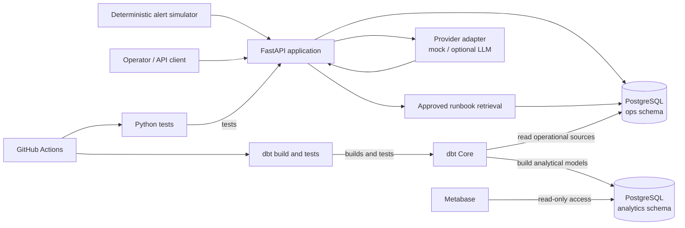
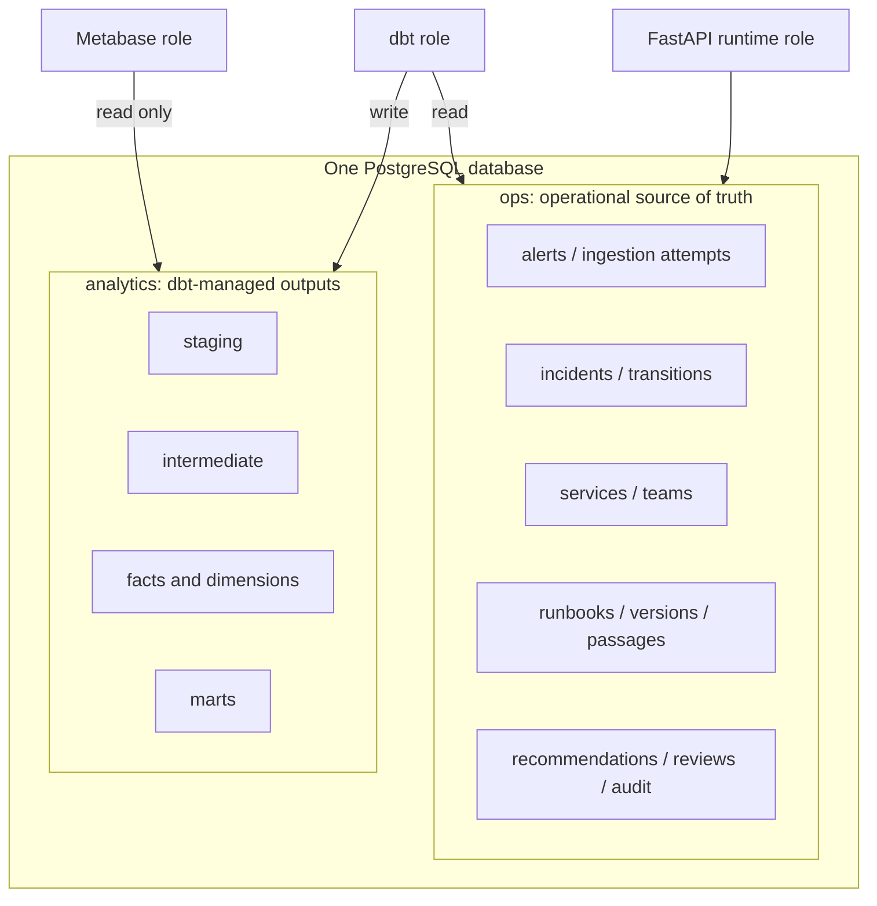
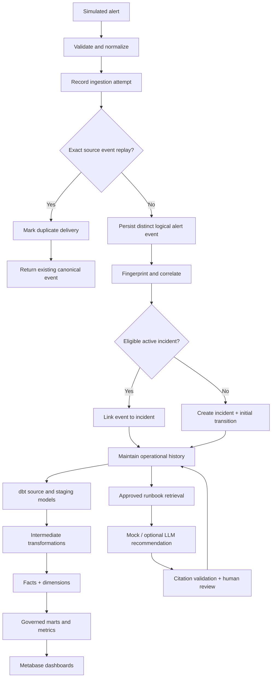
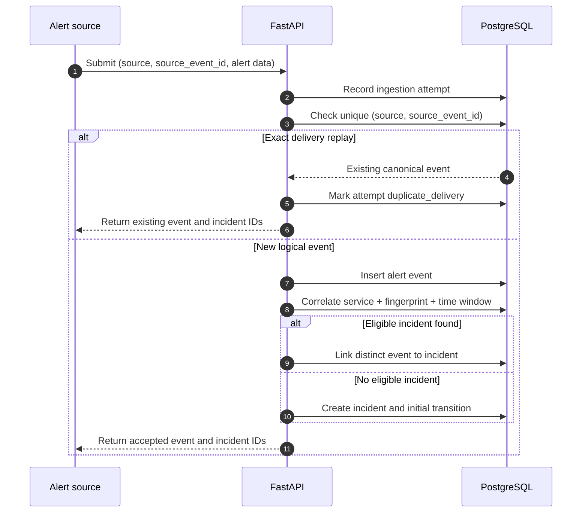
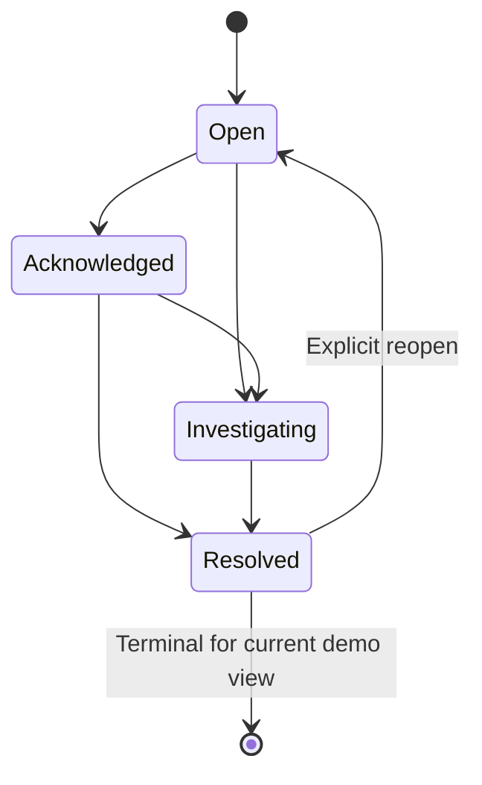
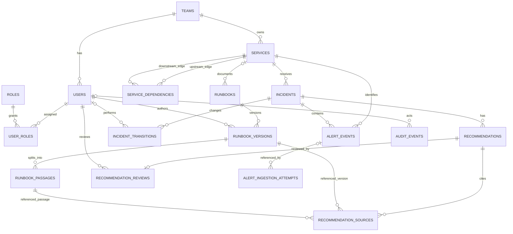
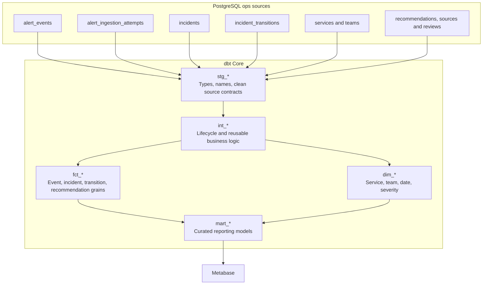

OpsPilot
Operational incident data, made decision-useful: reliable event identity, a governed incident lifecycle, tested dbt transformations, and evidence-grounded investigation support.
> **Project thesis.** Operational incident data becomes decision-useful only when event identity, incident lifecycle, ownership, metric definitions and evidence provenance are consistent. OpsPilot connects those controls in one reproducible system: **ingest → correlate → preserve history → transform → measure → investigate.**
> **Implementation status: MVP in development.** [`docs/implementation/IMPLEMENTATION_STATUS.md`](./docs/implementation/IMPLEMENTATION_STATUS.md) is the authoritative progress record. This README does not imply that unimplemented features are complete.
Status legend used in this document
Label	Meaning
Implemented	Confirmed complete in `IMPLEMENTATION_STATUS.md`
Planned	Scoped but not yet complete
Conceptual	Design intent or diagram only; not a production requirement
---

Raw operational events
        ↓
Reliable event identity + incident lifecycle
        ↓
Documented and tested dbt transformations
        ↓
Governed operational metrics
        ↓
Decision-ready dashboards and traceable investigation context
```
2. Product capabilities
> Per-capability status (Implemented / Planned / Conceptual): **[NEEDS INPUT — reconcile each bullet against `IMPLEMENTATION_STATUS.md`]**. The lists below describe the intended scope.
2.1 Operational platform
Validate and normalize simulated alert payloads.
Distinguish exact delivery retries from distinct repeat alert events.
Correlate related alerts into incidents with deterministic rules.
Maintain service ownership and dependency metadata.
Enforce a defined incident state machine.
Preserve transitions, review decisions and audit history.
2.2 Analytics engineering
Keep operational source tables separate from dbt-managed analytical models.
Use staging, intermediate, fact, dimension and mart layers.
Define explicit fact grains and reusable dimensions.
Test uniqueness, nullability, relationships, accepted values and business rules.
Document metrics, assumptions, eligibility, exclusions and lineage.
Reconcile analytical outputs against independent known fixtures.
2.3 Operational intelligence
Analyze incident volume, acknowledgement and resolution durations.
Compare service and team patterns.
Separate delivery replay rate from repeat-alert share.
Track recurrence using a defined seven-day observation rule.
Measure recommendation review outcomes without treating approval as proof of correctness.
2.4 AI-assisted investigation
Search approved, versioned runbooks and retrieve exact source passages.
Generate structured suggestions through a provider interface.
Validate citations against retrieved approved passages.
Return an explicit insufficient-evidence response when evidence is absent.
Require human review; generated instructions are never executed.
3. Architecture
3.1 System context

Figure 1. Operational ingestion, analytical transformation, BI consumption and the separate human-reviewed AI advisory path.

3.2 Responsibility boundaries
Component	Owns	Does not own
FastAPI	Request validation, application workflow, response contracts	Dashboard KPI definitions
PostgreSQL `ops`	Operational source of truth and event history	dbt-derived facts and marts
dbt	Reusable SQL transformations, tests, descriptions, lineage	Operational write workflows
PostgreSQL `analytics`	Curated analytical tables	Raw application mutation
Metabase	BI queries and dashboards over curated data	Independent copies of metric logic
Retrieval service	Approved runbook passage search and provenance	Autonomous diagnosis or execution
AI provider	Structured advisory text	Trusted data, authorization or remediation
3.3 Storage boundary

The schemas are separate ownership boundaries inside one database. The MVP does not claim a separate physical warehouse or multi-tenant isolation.
4. End-to-end data flow

The analytical path and the recommendation path share operational context, but neither changes the underlying event identity rules.
5. Event identity and ingestion correctness
Three concepts must remain separate:
Concept	Definition	Persistence behavior
Delivery attempt	One HTTP request received by OpsPilot	Recorded in `alert_ingestion_attempts`
Logical alert event	One distinct source event accepted by OpsPilot	One canonical row in `alert_events`
Fingerprint correlation	A normalized signature used to identify related alerts	Distinct accepted events may share a fingerprint and incident
Exact replay versus repeat alert

This design supports two different analytical questions:
Delivery replay rate: how often the same source event was delivered again.
Repeat-alert share: what share of accepted logical alert events were correlated to an existing incident.
A repeated fingerprint does not mean the new event is discarded.
6. Incident lifecycle

Only the listed transitions are allowed. Invalid transitions are rejected and do not silently update the current status.
Timestamp semantics
Field	Behavior
`first_acknowledged_at`	Set on the first transition to acknowledged and retained
`first_resolved_at`	Set on the first resolution and retained
`resolved_at`	Set on each resolution; cleared on reopen
`reopen_count`	Incremented on each reopen
A later resolution sets `resolved_at` again. Every transition has an append-only history record with actor and timestamp, so the current incident row is not the only source of lifecycle history.
7. Operational data model
The complete ERD and column-level definitions belong in `docs/architecture/ERD.md` and `docs/data/data-dictionary.md`. The conceptual core is shown below.

> **Modeling note.** This diagram is conceptual and intentionally condensed for readability. The operational TAD and data dictionary are authoritative for every entity, key, nullable field, constraint and cardinality. Do not infer unshown production requirements from this visual summary.
8. Analytics engineering and dbt
The analytics pipeline turns operational records into documented, tested and reusable datasets. Operational PostgreSQL tables (`ops`) are sources; everything in the `analytics` schema is dbt-managed output.
8.1 Transformation architecture

8.2 Layer responsibilities
Layer	Prefix	Responsibility
Staging	`stg_`	Types, names and clean source contracts
Intermediate	`int_`	Lifecycle and reusable business logic
Facts	`fct_`	Event, incident, transition and recommendation grains
Dimensions	`dim_`	Service, team, date and severity
Marts	`mart_`	Curated reporting models
8.3 Model inventory, tests, documentation and lineage
[NEEDS INPUT] Not covered by the content provided so far. To be filled from the dbt project (`models/`, `schema.yml`, `dbt_project.yml`):
Exact model names per layer, with grain and primary key
Data quality tests per model (uniqueness, nullability, relationships, accepted values, business rules)
Fixture reconciliation tests, if implemented
`dbt docs` generation and lineage notes
Metabase consumption details
Implementation status for each of the above
9. Governed metric catalog
[NEEDS INPUT] Metric names, definitions, eligibility rules and exclusions. Not in the content provided. The seven-day recurrence rule, delivery replay rate and repeat-alert share are referenced in sections 2 and 5, but their formal contracts are not yet supplied.
10. AI-assisted triage and evidence controls
[NEEDS INPUT] Retrieval, provider abstraction, citation validation, insufficient-evidence behavior and human review workflow. Intent is summarized in section 2.4.
11. Evaluation methodology
[NEEDS INPUT]
12. Dashboards
[NEEDS INPUT] No screenshots or dashboard descriptions are included until verified assets exist.
13. Repository structure
[NEEDS INPUT] To be generated from the actual repository tree.
14. Local setup
[NEEDS INPUT] Prerequisites, commands and environment variables to be taken from the repository.
15. API overview
[NEEDS INPUT] Endpoints to be taken from the OpenAPI spec or routers.
16. Quality, testing and CI
[NEEDS INPUT] Python test suites, dbt build/test steps and GitHub Actions workflows. Section 3.1 shows the intended CI shape only.
17. Security and safety boundaries
[NEEDS INPUT] Role separation (FastAPI runtime, dbt, Metabase read-only) and AI advisory-only constraints are described above; remaining controls to be supplied.
18. Design decisions and trade-offs
[NEEDS INPUT] Known so far: single database with separate `ops` and `analytics` schemas; mock-first AI provider; PostgreSQL full-text search for retrieval; deterministic synthetic demo data.
19. Limitations and roadmap
[NEEDS INPUT] Known so far: no separate physical warehouse, no multi-tenant isolation, no production telemetry.
20. Demo walkthrough
[NEEDS INPUT]
21. Project documentation
Document	Purpose
`docs/implementation/IMPLEMENTATION_STATUS.md`	Authoritative implementation progress
`docs/architecture/ERD.md`	Entity-relationship diagram
`docs/data/data-dictionary.md`	Authoritative entity, key, nullability and constraint definitions
[NEEDS INPUT] Remaining documents under `docs/`. Paths above are taken from the existing README and not yet verified against the repository.
