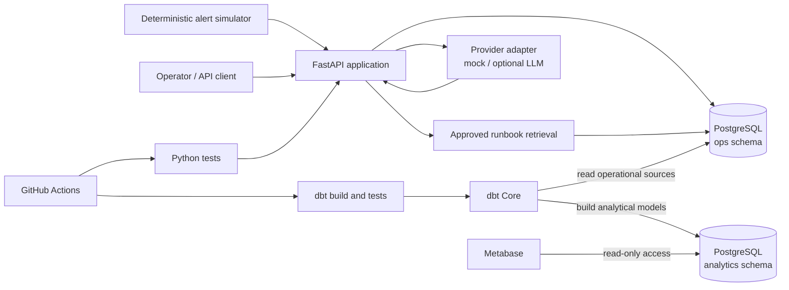
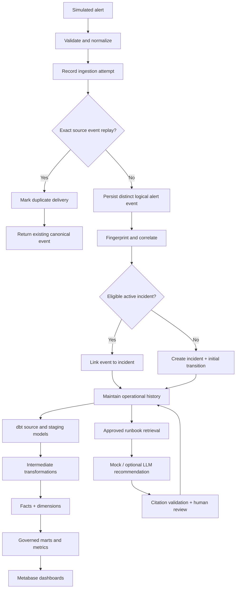
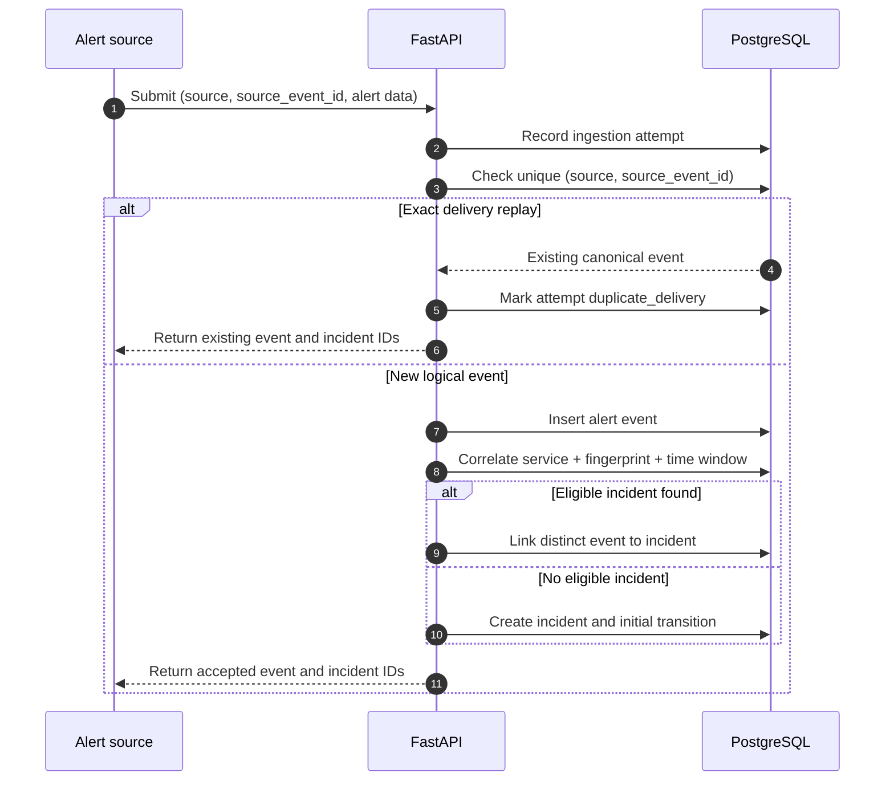
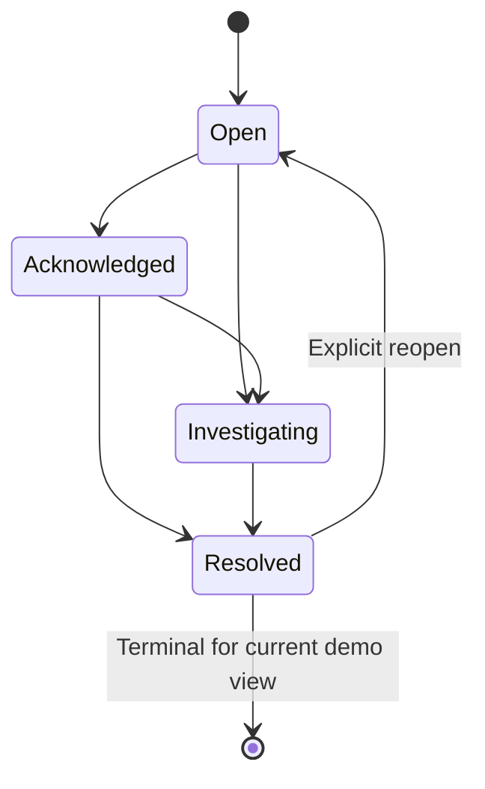
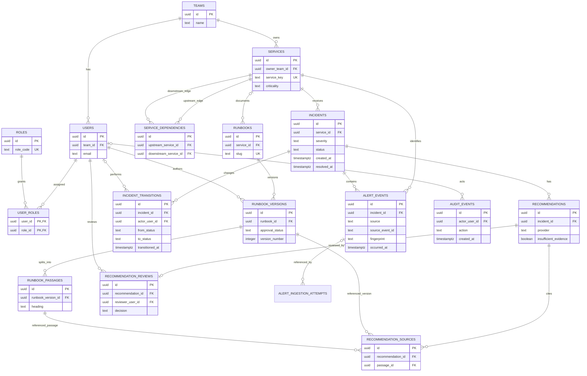
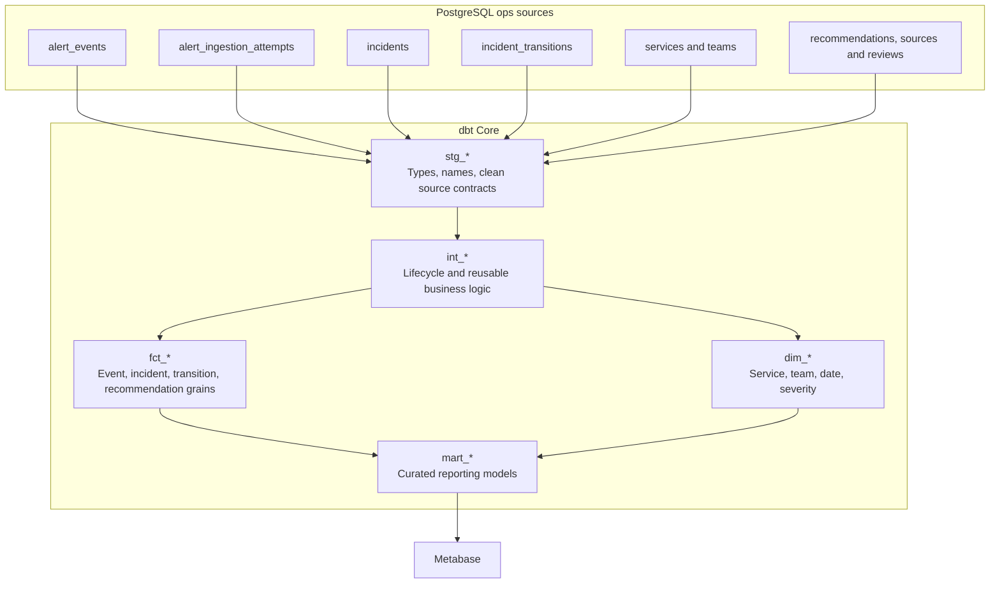
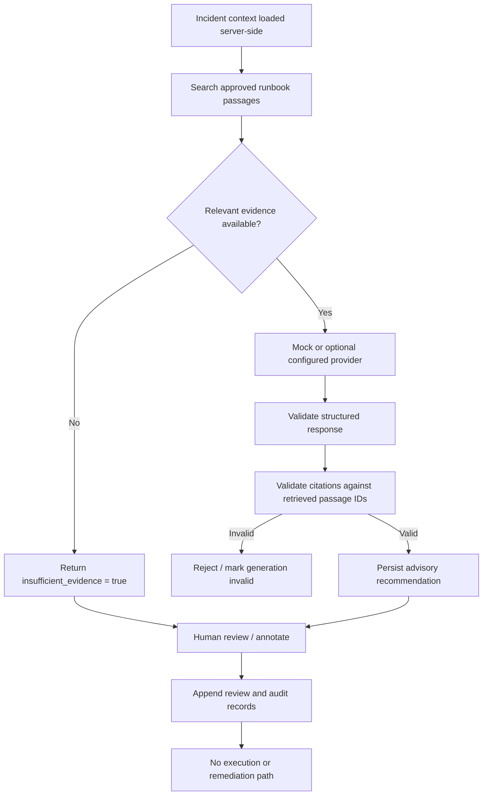

<!--
OpsPilot README starter / publication template.
Keep claims, metrics, status, screenshots, badges, links and commands synchronized
with the actual repository and test output. Remove all TODO markers before calling
this a final portfolio README. Do not invent benchmark values or implementation status.
<div align="center">
OpsPilot
Turn operational events into trusted reliability intelligence.
An analytics-first IT operations platform with evidence-grounded, human-reviewed incident triage.
<p>
  <a href="./docs/product/PRD.md">Product Requirements</a> ·
  <a href="./docs/architecture/TAD.md">Technical Architecture</a> ·
  <a href="./docs/data/data-dictionary.md">Data Dictionary</a> ·
  <a href="./docs/metrics/metric-definitions.md">Metric Contracts</a>
</p>
<!-- Replace OWNER/REPO with the actual GitHub coordinates before publishing. -->
<!-- Add the CI badge only after the workflow exists in this repository. -->


</div>
---
> **Project thesis** — Operational incident data becomes decision-useful only when event identity, incident lifecycle, ownership, metric definitions and evidence provenance are consistent. OpsPilot connects those controls in one reproducible system: ingest → correlate → preserve history → transform → measure → investigate.
<!-- TODO: Replace this status statement with verified completion status. -->
> **Implementation status:** MVP in development. The repository's `docs/implementation/IMPLEMENTATION_STATUS.md` is the authoritative progress record. This README must not imply that unimplemented features are complete.
---
At a glance
<table>
  <tr>
    <td width="25%" align="center"><strong>01</strong><br/><sub>Operational data</sub><br/>Validated alerts and incident history</td>
    <td width="25%" align="center"><strong>02</strong><br/><sub>Analytics engineering</sub><br/>Tested dbt facts, dimensions and marts</td>
    <td width="25%" align="center"><strong>03</strong><br/><sub>Operational intelligence</sub><br/>Governed metrics and dashboards</td>
    <td width="25%" align="center"><strong>04</strong><br/><sub>Evidence-grounded AI</sub><br/>Cited suggestions with human review</td>
  </tr>
</table>
Dimension	Design
Primary user	On-call engineer; secondary users include analysts, service owners and engineering managers
Primary portfolio focus	Analytics Engineering: SQL, dimensional modeling, dbt, data quality, metric governance and BI
Operational interface	FastAPI + OpenAPI/Swagger
Operational persistence	PostgreSQL `ops` schema
Analytical transformation	dbt Core + PostgreSQL adapter
Analytical output	PostgreSQL `analytics` schema
BI consumer	Metabase with read-only analytics access
Knowledge retrieval	PostgreSQL full-text search over approved runbook versions
AI posture	Mock-first provider abstraction; optional LLM; advisory only
Demo data	Deterministic synthetic incidents and alerts; no production telemetry
Contents
1. Problem and motivation
2. Product capabilities
3. Architecture
4. End-to-end data flow
5. Event identity and ingestion correctness
6. Incident lifecycle
7. Operational data model
8. Analytics engineering and dbt
9. Governed metric catalog
10. AI-assisted triage and evidence controls
11. Evaluation methodology
12. Dashboards
13. Repository structure
14. Local setup
15. API overview
16. Quality, testing and CI
17. Security and safety boundaries
18. Design decisions and trade-offs
19. Limitations and future work
20. Demo walkthrough
21. Project documentation
---
1. Problem and motivation
Incident response data is fragmented across alert notifications, service metadata, lifecycle changes, troubleshooting documents and reviewer decisions. Even when the underlying events are available, teams can struggle to answer basic questions consistently:
How many distinct incidents occurred in a reporting period?
How long did acknowledged incidents take to receive their first acknowledgement?
How long did finally resolved incidents remain open, including reopen cycles?
Which services generate repeated alert events or recurring failures?
Which runbook passage supports a proposed investigation step?
Can the reported KPI be traced to a tested transformation and an explicit eligibility rule?
OpsPilot demonstrates a compact answer to those questions. It uses an operational application to create traceable source records, then treats the analytical layer as a first-class product: dbt models define reusable transformations, tests enforce data quality, metric contracts govern business logic, and Metabase presents curated reporting models.
Product thesis
```text
Raw operational events
        ↓
Reliable event identity + incident lifecycle
        ↓
Documented and tested dbt transformations
        ↓
Governed operational metrics
        ↓
Decision-ready dashboards and traceable investigation context
```
2. Product capabilities
Operational platform
Validate and normalize simulated alert payloads.
Distinguish exact delivery retries from distinct repeat alert events.
Correlate related alerts into incidents with deterministic rules.
Maintain service ownership and dependency metadata.
Enforce a defined incident state machine.
Preserve transitions, review decisions and audit history.
Analytics engineering
Keep operational source tables separate from dbt-managed analytical models.
Use staging, intermediate, fact, dimension and mart layers.
Define explicit fact grains and reusable dimensions.
Test uniqueness, nullability, relationships, accepted values and business rules.
Document metrics, assumptions, eligibility, exclusions and lineage.
Reconcile analytical outputs against independent known fixtures.
Operational intelligence
Analyze incident volume, acknowledgement and resolution durations.
Compare service and team patterns.
Separate delivery replay rate from repeat-alert share.
Track recurrence using a defined seven-day observation rule.
Measure recommendation review outcomes without treating approval as proof of correctness.
AI-assisted investigation
Search approved, versioned runbooks.
Retrieve exact source passages.
Generate structured suggestions through a provider interface.
Validate citations against retrieved approved passages.
Return an explicit insufficient-evidence response when evidence is absent.
Require a human review; never execute generated instructions.
3. Architecture
3.1 System context

Figure 1. Operational ingestion, analytical transformation, BI consumption and the separate human-reviewed AI advisory path.

3.2 Responsibility boundaries
Component	Owns	Does not own
FastAPI	Request validation, application workflow and response contracts	Dashboard KPI definitions
PostgreSQL `ops`	Operational source of truth and event history	dbt-derived facts/marts
dbt	Reusable SQL transformations, tests, descriptions and lineage	Operational write workflows
PostgreSQL `analytics`	Curated analytical tables	Raw application mutation
Metabase	BI queries and dashboards over curated data	Independent copies of metric logic
Retrieval service	Approved runbook passage search and provenance	Autonomous diagnosis or execution
AI provider	Structured advisory text	Trusted data, authorization or remediation
3.3 Storage boundary

The schemas are separate ownership boundaries inside one database. The MVP does not claim a separate physical warehouse or multi-tenant isolation.
4. End-to-end data flow

The analytical path and recommendation path share operational context, but neither changes the underlying event identity rules.
5. Event identity and ingestion correctness
Three concepts must remain separate:
Concept	Definition	Persistence behavior
Delivery attempt	One HTTP request received by OpsPilot	Record in `alert_ingestion_attempts`
Logical alert event	One distinct source event accepted by OpsPilot	One canonical row in `alert_events`
Fingerprint correlation	A normalized signature used to identify related alerts	Distinct accepted events may share a fingerprint and incident
Exact replay versus repeat alert

This design supports two different analytical questions:
Delivery replay rate: How often did the same source event get delivered again?
Repeat-alert share: What share of accepted logical alert events were correlated to an existing incident?
A repeated fingerprint does not mean the new event is discarded.
6. Incident lifecycle

Only the listed transitions are allowed. Invalid transitions are rejected and do not silently update the current status.
Timestamp semantics
`first_acknowledged_at` is set on the first transition to acknowledged and is retained.
`first_resolved_at` is set on the first resolution and is retained.
Current `resolved_at` is set on each resolution.
Reopening clears current `resolved_at` and increments `reopen_count`.
A later resolution sets `resolved_at` again.
Every transition has an append-only history record with actor and timestamp. The current incident row is not the only source of lifecycle history.
7. Operational data model
The complete ERD and column-level definitions belong in `docs/architecture/ERD.md` and `docs/data/data-dictionary.md`. The conceptual core is shown below.

> **Modeling note:** The diagram is conceptual and intentionally condensed for readability. The operational TAD/data dictionary is authoritative for every entity, key, nullable field, constraint and cardinality. Do not infer unshown production requirements from this visual summary.
8. Analytics engineering and dbt
The defining analytics pipeline turns operational records into documented, tested and reusable datasets.

Intended model layers
Layer	Naming	Responsibility	Example models
Sources	`source()`	Declare operational source contracts	`ops.alert_events`, `ops.incidents`
Staging	`stg_*`	Rename, cast, normalize and lightly clean	`stg_alert_events`, `stg_incidents`
Intermediate	`int_*`	Reusable lifecycle and business logic	`int_incident_lifecycle`, `int_incident_response_times`
Facts	`fct_*`	Measurable business events at explicit grain	`fct_alert_events`, `fct_incidents`, `fct_incident_transitions`, `fct_recommendations`
Dimensions	`dim_*`	Descriptive analytical context	`dim_services`, `dim_teams`, `dim_dates`, `dim_severity`
Marts	`mart_*`	Dashboard-ready governed outputs	`mart_incident_operations`, `mart_service_performance`, `mart_alert_noise`, `mart_recommendation_quality`
Fact grain is part of the contract
Fact model	Grain
`fct_alert_events`	One row per accepted logical alert event
`fct_incidents`	One row per incident
`fct_incident_transitions`	One row per recorded status transition
`fct_recommendations`	One row per generated recommendation
Every fact must document its grain, key, event timestamp(s), dimensions, additive measures and known limitations. Tests must detect duplicate grain and unintended join fan-out.
9. Governed metric catalog
Metric names are not enough. Each metric needs an explicit grain, formula, eligibility rule, denominator, exclusions and timestamp semantics. The full metric contracts and SQL references live in `docs/metrics/metric-definitions.md`.
Metric	Contract summary	Important caveat
Incident volume	Distinct incidents by creation date	Exclude only explicitly identified test/seed records from the production-style view
MTTA	Average first acknowledgement time minus creation time	Acknowledged incidents only; show eligible count
MTTR	Average current/final `resolved_at` minus creation time for currently resolved incidents	Reopen clears current resolution; retains first resolution and reopen count; show eligible count
Recurrence rate	Recurring eligible incidents / incidents with a complete seven-day observation window	Same service + fingerprint; new incident occurs within seven days after prior resolution; not proof of common root cause
Repeat-alert share	Accepted events correlated to an existing incident / all accepted logical alert events	Repeat events are retained; not dropped-row rate
Delivery replay rate	Exact replay attempts / validly evaluated ingestion attempts	Replays are stored as attempts, not additional canonical alert events
Recommendation acceptance	Approved / (approved + rejected) recommendations	Unreviewed recommendations excluded; approval is not correctness
Citation validation rate	Recommendations whose cited references all pass structural validation / recommendations with at least one citation	Structural validity is not semantic evidence support
Insufficient-evidence frequency	Successful recommendations explicitly marked insufficient evidence / all successful recommendations	Evaluate alongside retrieval coverage and query category
Metric governance principles
A metric is implemented once in the dbt layer and reused by dashboards.
Rates expose their denominator and eligible sample count.
Invalid negative durations fail quality tests; they are not silently included.
Averages are labeled as averages; medians are separate statistics.
Recurrence eligibility excludes the newest seven days so every eligible incident has a complete observation window.
Incident data alone does not establish service uptime or availability.
SLA breach rate is deferred until an explicit SLA policy and eligibility logic exist.
10. AI-assisted triage and evidence controls

Evidence contract
Only approved immutable runbook versions are searchable.
A citation includes the exact runbook version and passage identity.
The backend verifies the reference exists and belongs to the retrieved candidate set.
Suggestions without supporting evidence are not presented as grounded actions.
Possible contributors are hypotheses, not confirmed root causes.
No-evidence requests return an explicit fallback and no invented sources.
Human approval/rejection is an audit event, not proof of technical success.
AI evaluation is separate from retrieval evaluation
Evaluation	What it checks	What it does not prove
Citation validity	Source IDs exist, are approved and were retrieved	Advice is semantically correct
Evidence support review	Human-labeled reviewer judges whether cited text supports the suggestion	Production efficacy
Schema completeness	Required fields and types are present	Diagnosis accuracy
Fallback correctness	No-evidence cases decline to invent sources	That every insufficient-evidence case was detected
Review outcomes	Human approval/rejection distribution	Successful remediation
11. Evaluation methodology
OpsPilot is evaluated using a deterministic synthetic environment, not customer production telemetry. The starter generator targets are design targets, not observed results.
Dataset component	Starter target
Services	10–20
Teams	5–8
Accepted logical alert events	10,000–20,000
Incidents	500–1,500
Runbooks	20–40
Recommendations	200–500
Simulated history	Approximately 3 months
Labeled retrieval cases	30–50
The generator should produce exact delivery replays, distinct repeat fingerprints, dependency cascades, critical/low severity cases, unresolved/unacknowledged incidents, reopen cycles, post-resolution recurrence, reviewed/unreviewed recommendations, and both evidence-present and evidence-absent cases. It should accept a seed and record generator version/configuration in a manifest.
Retrieval metrics
Precision@K: fraction of top-K retrieved passages that are labeled relevant.
Recall@K: fraction of labeled relevant passages recovered in the top-K.
MRR: mean reciprocal rank of the first relevant result.
Report macro averages and per-category performance only when sample size supports interpretation. Publish the labeled queries, evaluation script, K value, run configuration and limitations.
Data and metric correctness
Use independent fixtures with hand-calculated expected answers for incident volume, MTTA, MTTR (including reopen), recurrence eligibility, repeat-alert share, delivery replay rate, recommendation acceptance and citation validation. The expected outputs must not be generated by the dbt SQL being tested.
Reported results
<!-- TODO: Replace with generated values only after running the relevant scripts. -->
Measure	Result	Evidence
Python test suite	Not yet measured	`pytest` output / CI run
dbt model build and tests	Not yet measured	`dbt build` artifact/log
Metric reconciliation	Not yet measured	`docs/evaluation/data-quality-report.md`
Retrieval Precision@K	Not yet measured	`docs/evaluation/retrieval-evaluation.md`
Retrieval Recall@K	Not yet measured	`docs/evaluation/retrieval-evaluation.md`
MRR	Not yet measured	`docs/evaluation/retrieval-evaluation.md`
Citation structural validity	Not yet measured	`docs/evaluation/recommendation-evaluation.md`
Human evidence-support assessment	Not yet measured	`docs/evaluation/recommendation-evaluation.md`
> Do not replace “Not yet measured” with invented percentages. Record sample size, benchmark version, seed, evaluation date and known limitations for every published result.
12. Dashboards
The intended Metabase dashboard set is:
Dashboard	Questions answered	Key views
Executive overview	What is happening across operations?	Incident volume, open/critical incidents, MTTA, MTTR, recurrence, trend
Service performance	Which services are most affected?	Incidents by service, MTTA/MTTR, severity mix, repeat failures
Alert and incident analytics	Where is alert noise coming from?	Accepted event volume, delivery replay rate, repeat-alert share, category/severity, duration
Recommendation quality	How is the assistant being used and reviewed?	Recommendation volume, approvals/rejections, acceptance, citation validation, insufficient evidence
All dashboard cards should query curated marts or approved facts. Show sample counts next to averages/rates, expose meaningful date/service/team/severity filters, and label the dataset synthetic/demo.
<!-- TODO: Replace this panel with real screenshots after Metabase is configured. -->
<details>
  <summary><strong>Dashboard screenshots — add after local setup</strong></summary>
Save actual screenshots under `docs/screenshots/` and add them here with descriptive alt text. Do not add mock screenshots or imagery that suggests a dashboard exists before it has been built.
Suggested captures:
`docs/screenshots/executive-overview.png`
`docs/screenshots/service-performance.png`
`docs/screenshots/alert-analytics.png`
`docs/screenshots/recommendation-quality.png`
</details>
13. Repository structure
The final tree should reflect the actual repository. The target organization is:
```text
opspilot/
├── app/                         # FastAPI application
│   ├── api/v1/                  # HTTP routers
│   ├── core/                    # Configuration, DB, security, errors, logging
│   ├── models/                  # SQLAlchemy operational models
│   ├── schemas/                 # Pydantic contracts
│   ├── repositories/            # Database access
│   ├── services/                # Domain logic
│   └── providers/               # Mock / optional LLM adapter
├── migrations/                 # Alembic migrations
├── dbt/                         # dbt Core project
│   ├── models/
│   │   ├── staging/
│   │   ├── intermediate/
│   │   └── marts/
│   ├── tests/
│   ├── macros/
│   ├── seeds/
│   └── snapshots/
├── scripts/
│   ├── seed_demo_data.py
│   ├── generate_data/
│   └── evaluation/
├── tests/
│   ├── unit/
│   ├── integration/
│   └── security/
├── docs/
│   ├── product/
│   ├── architecture/
│   ├── requirements/
│   ├── data/
│   ├── metrics/
│   ├── evaluation/
│   ├── demo/
│   ├── screenshots/
│   └── implementation/
├── infra/docker/
├── .github/workflows/
├── .env.example
├── .gitignore
├── Dockerfile
├── docker-compose.yml
├── pyproject.toml
└── README.md
```
14. Local setup
> **Important:** The commands below are the intended workflow. Replace or refine them to match the actual scripts and environment in this repository. Only describe a command as verified after running it successfully.
14.1 Prerequisites
Python 3.12 or compatible version supported by the pinned project dependencies.
Docker Desktop with Docker Compose.
Git.
Optional: a browser for FastAPI Swagger and Metabase.
No paid LLM key is required for the mock-provider path.
14.2 Clone and configure
```powershell
 git clone https://github.com/<OWNER>/opspilot.git
 cd opspilot
 Copy-Item .env.example .env
```
Edit `.env` locally. Never commit it.
14.3 Create the Python environment
```powershell
py -3.12 -m venv .venv
.\.venv\Scripts\Activate.ps1
python -m pip install --upgrade pip
pip install -e ".[dev]"
```
> Use the exact extras and package-install command defined by the final `pyproject.toml`. If the project uses a lockfile/alternative manager, document that verified command instead.
14.4 Start infrastructure and migrate
```powershell
docker compose up -d postgres
# Wait until PostgreSQL health check is healthy.
alembic upgrade head
```
14.5 Seed and generate synthetic scenarios
```powershell
python -m scripts.seed_demo_data
python -m scripts.generate_data.generate_incidents --seed 42
```
The generator must report its seed, version/configuration, accepted events, incidents, ingestion replays, repeat events and scenario counts. Use only an explicitly documented demo dataset; never silently truncate a non-demo database.
14.6 Start the API
```powershell
uvicorn app.main:app --reload
```
Open:
API health: `http://localhost:8000/health`
OpenAPI / Swagger: `http://localhost:8000/docs`
ReDoc: `http://localhost:8000/redoc`
14.7 Build dbt models and docs
```powershell
Set-Location dbt
dbt deps
dbt build --target dev
dbt docs generate
dbt docs serve
```
Use the actual profile/target configuration in the repository. Do not place database credentials in the committed `profiles.yml`.
14.8 Start Metabase
```powershell
docker compose --profile bi up -d metabase
```
Open `http://localhost:3000` unless the final Compose configuration maps a different port. Connect with the dedicated read-only `opspilot_metabase` account and select the `analytics` schema only. Follow the dashboard setup guide if saved questions/dashboards are not provisioned automatically.
14.9 Run quality checks
```powershell
ruff check .
ruff format --check .
pytest
Set-Location dbt
dbt build --target dev
```
Use the actual verified commands and any separate integration/security test markers defined by the project.
15. API overview
The API is the operational interface; Metabase is the analytical interface.
Method	Route	Purpose
`GET`	`/health`	Application/database readiness
`POST`	`/api/v1/alerts`	Validate, persist and correlate an alert
`GET`	`/api/v1/incidents`	Paginated incident search and filters
`GET`	`/api/v1/incidents/{incident_id}`	Incident, events and current state
`PATCH`	`/api/v1/incidents/{incident_id}/status`	Request an allowed status transition
`GET`	`/api/v1/incidents/{incident_id}/timeline`	Ordered event and transition history
`GET`	`/api/v1/services`	List services
`POST`	`/api/v1/services`	Create service (admin)
`GET`	`/api/v1/services/{service_id}`	Service and dependency detail
`GET`	`/api/v1/runbooks/search`	Search approved runbook passages
`POST`	`/api/v1/incidents/{incident_id}/recommendations`	Generate advisory suggestion
`GET`	`/api/v1/recommendations/{recommendation_id}`	Retrieve recommendation and sources
`POST`	`/api/v1/recommendations/{recommendation_id}/review`	Human approval/rejection
`POST`	`/api/v1/runbooks`	Create runbook (admin)
`POST`	`/api/v1/runbooks/{runbook_id}/versions`	Create draft version
`POST`	`/api/v1/runbook-versions/{version_id}/approve`	Approve/publish version
See the generated OpenAPI schema at `/docs` for the exact request/response schemas, auth requirements and error codes.
16. Quality, testing and CI
Testing follows the system's trust boundaries rather than focusing only on endpoint happy paths.
Test layer	Examples
Python unit tests	Normalization, fingerprinting, transition matrix, severity ordering, citation validation
API/integration tests	Alert acceptance, exact replay, distinct repeat events, filters, lifecycle and audit writes
Concurrency tests	Concurrent exact replays and concurrent correlation attempts
dbt tests	Grain uniqueness, not-null, relationships, accepted values and domain-specific SQL tests
Reconciliation	Independent expected MTTA/MTTR, recurrence, replay, repeat-alert and recommendation metrics
Retrieval evaluation	Labeled relevant passages; Precision@K, Recall@K and MRR
AI evaluation	Citation validity, evidence support, schema completeness, fallback behavior
Security tests	Role restrictions, oversized payloads, secret redaction, approved source filtering and non-execution
<!-- TODO: Add actual workflow badge and observed CI state after first successful run. -->
The CI workflow should run deterministic tests with a disposable PostgreSQL database and mock AI provider. It must not depend on a paid external model or production credentials.
17. Security and safety boundaries
Synthetic/demo data only; no real production integration in the MVP.
No secret-bearing log ingestion.
No production credentials or API keys committed to source control.
Passwords are stored using a vetted password-hashing algorithm.
Actor and reviewer identity comes from the authenticated principal.
Role checks are enforced in the application.
Metabase has read-only access to `analytics` only.
The application does not own/write dbt-derived models.
Approved runbook versions are immutable after publication.
Recommendation citations must reference retrieved, approved passages.
Generated recommendations are advisory; there is no remediation executor.
Audit records are append-only to the normal application role. This is not protection from a database administrator/superuser.
18. Design decisions and trade-offs
Decision	Why this is the MVP choice	Trade-off / trigger to revisit
One PostgreSQL database, two schemas	Separates operational and analytical ownership without extra infrastructure	Separate warehouse may be justified by scale, workload isolation or cloud goals
dbt Core	Makes SQL models, tests, docs and lineage explicit	Requires disciplined model contracts and build workflow
Dimensional facts/dimensions	Supports stable grains and reusable reporting	Avoid over-modeling; add complexity only when use cases demand it
Metabase	BI without spending time on a custom frontend	Dashboard setup may require a local UI workflow
Full-text search first	Simple, inspectable and measurable baseline	Add embeddings only after a labeled evaluation shows a meaningful gap
Mock-first AI provider	Reproducible tests and no paid service requirement	A real provider may produce variable results and needs separate evaluation
Single-organization MVP	Avoids unused tenant-isolation complexity	Revisit identity and database boundaries before multi-customer use
Synchronous workflow first	Minimizes infrastructure and moving parts	Add a job queue only when measured latency/load requires it
No autonomous remediation	Keeps the system advisory and safer	Production automation is outside the project scope
19. Limitations and future work
MVP limitations
Synthetic data cannot represent the full distribution or complexity of real enterprise incidents.
Retrieval quality is meaningful only relative to the labeled benchmark and its annotation quality.
Citation validity does not establish that an instruction is correct or safe for every environment.
Human review acceptance is not a remediation success metric.
No real infrastructure telemetry or service availability measurement is included.
The single-organization design does not claim multi-tenant SaaS isolation.
Deferred enhancements
Embedding/vector retrieval after keyword-search evaluation.
Background queue for demonstrated asynchronous workload.
Separate warehouse (for example, BigQuery or Snowflake) if cloud/scale goals justify it.
More extensive slowly changing dimensions where effective-dated source history exists.
Additional observability instrumentation and traces.
More sophisticated incident correlation evaluated against labeled scenarios.
20. Demo walkthrough
A five-minute walkthrough should show the system's core trust and analytics properties:
Step	Demonstration	Expected evidence
1. Exact replay	Submit the same `(source, source_event_id)` twice	One canonical alert event; two ingestion attempts; replay identified
2. Repeat fingerprint	Submit a distinct source event with a matching fingerprint	New event retained and linked to eligible incident
3. Lifecycle	Acknowledge, investigate, resolve, then explicitly reopen	Allowed transitions, preserved history and timestamp behavior
4. Grounded triage	Trigger an incident with a matching approved runbook	Recommendation cites the retrieved version and passage
5. Missing evidence	Trigger a scenario with no relevant approved runbook	Explicit insufficient-evidence fallback; no invented citation
6. Human review	Reject or approve a recommendation	Reviewer identity, decision and timestamp in audit history
7. Analytics	Build dbt and inspect Metabase dashboards	Tested models and metric outputs reconcile to known fixtures
21. Project documentation
Document	Description
`docs/product/PRD.md`	Product goals, personas, scope and acceptance criteria
`docs/architecture/TAD.md`	System architecture, database, API, security and implementation order
`docs/architecture/ERD.md`	Detailed operational and analytical entity relationships
`docs/data/data-dictionary.md`	Column-level definitions, types, nullability and business meaning
`docs/metrics/metric-definitions.md`	Governed metrics and formulas
`docs/evaluation/retrieval-evaluation.md`	Labeled retrieval methodology and results
`docs/evaluation/recommendation-evaluation.md`	Citation, grounding and fallback evaluation
`docs/evaluation/data-quality-report.md`	dbt tests and metric reconciliation
`docs/requirements/requirements-traceability.md`	PRD/TAD requirements mapped to code and tests
`docs/implementation/IMPLEMENTATION_STATUS.md`	Current implementation and verification status
`docs/demo/demo-script.md`	Reproducible demo sequence
---
<div align="center">
OpsPilot · Reliable events. Governed metrics. Evidence before action.
<sub>Built as a reproducible portfolio project. Synthetic data only. Human oversight by design.</sub>
</div>
